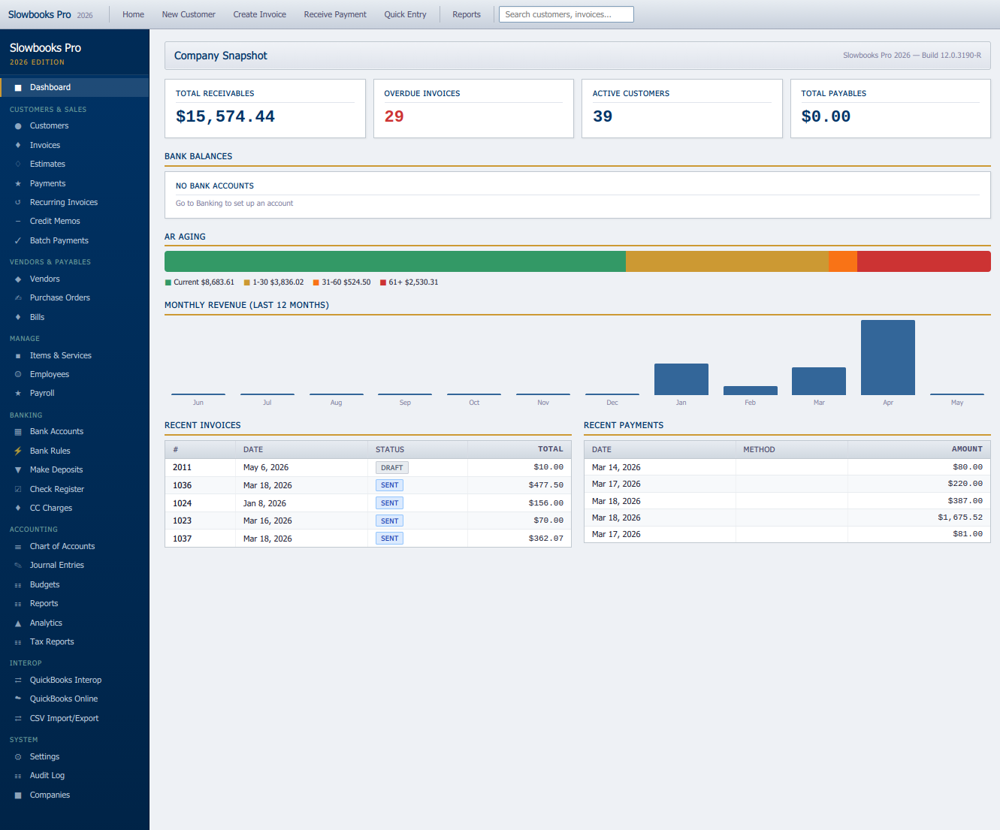
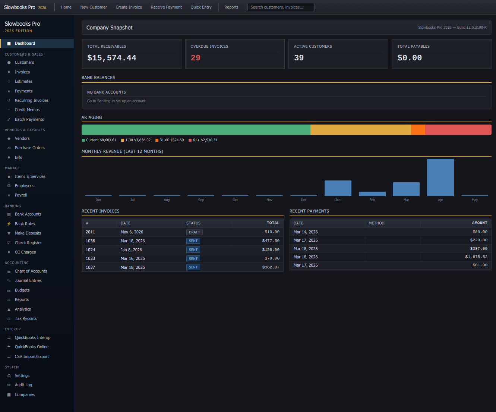
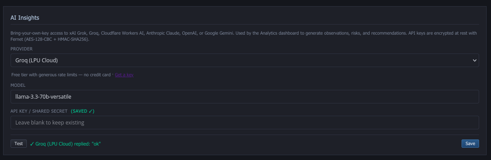
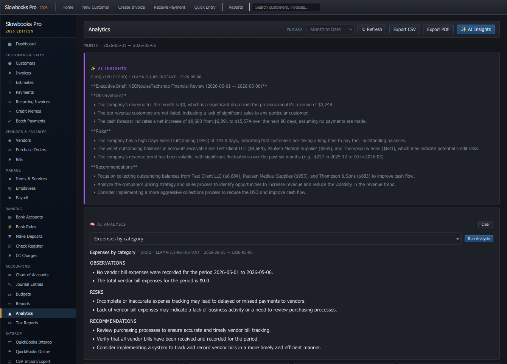
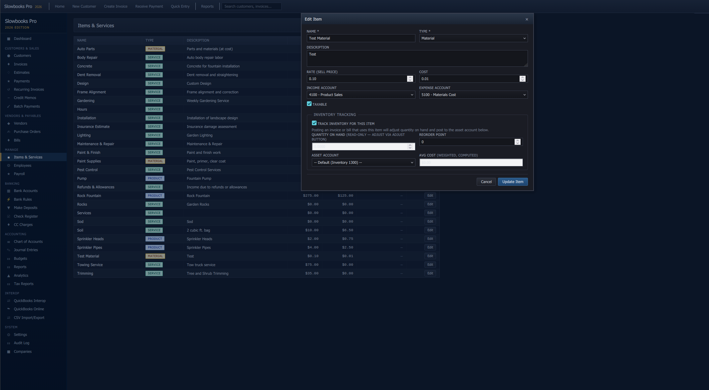
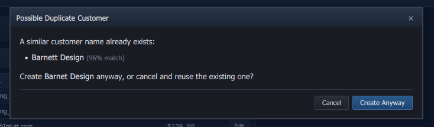

# Features

Full feature catalog for Slowbooks Pro 2026. The README keeps the
elevator pitch; everything an evaluator would scroll through lives
here.

For module-deep references (models, routes, UI pages, pending items),
see [docs/payroll-hr-module.md](payroll-hr-module.md) for payroll/HR,
[docs/security-hardening.md](security-hardening.md) for the security
pass, and the per-integration setup guides ([Stripe](setup-stripe.md),
[TLS proxy](tls-proxy-setup.md)).

---

## Invoicing & Payments (Accounts Receivable)
- **Invoices** — Create, edit, duplicate, void, mark as sent, email as PDF. Auto-numbering, auto due-date from terms, dynamic line items with running totals. Print/PDF generation via WeasyPrint. Inline customer creation from invoice form. **Draft means not yet marked sent, not unposted:** creating an invoice posts it to the books at once (A/R and income, and inventory-tracked items come out of stock); Mark Sent changes the status and posts nothing more. The form says so beside Create (v2.23.0, #293) **Quantities keep four decimal places** (v2.23.0): a line's quantity is stored to four places as unit prices are, shown as entered (2.125; 3.00 as before), refused finer, on invoices, estimates, credit memos, recurring invoices, bills, purchase orders and vendor credits — the imports stored a finer quantity and every read gave two places, so an edit took cents off the document
- **Sales Receipts** — One-screen invoice + payment for point-of-sale style sales where the customer pays on the spot. Payment method, deposit-to account, and line items on a single form; posts both documents and their journal entries atomically. Imports from QuickBooks Desktop (IIF `CASH SALE`) and QuickBooks Online (SalesReceipt API)
- **Receipt scanning (Tier 2 OCR)** — A Scan Receipt button on the Sales Receipt and Bill forms uploads a receipt image or PDF and pre-fills the form from local OCR: date, merchant/vendor hint, and the grand total as a single line, with detected tax split out (tax-rate field on sales receipts; noted in Bill Notes). The operator always reviews before saving, and the source file attaches to the document. On Windows and macOS the OS engine reads the text and the OS renders PDF pages, so nothing is installed; on Linux, Tesseract + poppler-utils are user-installed system binaries called via subprocess — zero new Python dependencies, never bundled, graceful "install Tesseract to enable scanning" degrade. Deterministic parsing, no AI. Spec: [docs/design/receipt-intake-spec.md](design/receipt-intake-spec.md)
- **Estimates** — Full estimate workflow with convert-to-invoice: the invoice is dated the day it is made, due by the customer's terms, addressed to the customer (the estimate is addressed when saved). Inline customer creation from estimate form
- **Write Off** (v2.22.2, #255) — forgive an open balance in any company, not only a nonprofit: a credit memo to Bad Debt Expense, applied to the invoice at once, voidable to undo. From **A/R Aging**, **Write off balances under…** a figure you type lists the open invoices under it, each with a tick, and posts one credit memo per invoice together; a balance that changed since the list was made (a payment landed) is left alone and named, and a closed period refuses the batch
- **Payments** — Record payments with allocation across multiple invoices. Typing the amount fills the Apply column oldest invoice first (change any of it); money left over is kept as a customer credit only when you tick the box that says so. Draft invoices can be paid too. Auto-updates invoice balances and status (draft/sent/partial/paid). Void payments with reversing journal entries — refused while the payment is in a deposit, and once that deposit is reconciled. **Retry-safe recording** (v2.23.0, #292): a client that may send a request twice — a form after a lost response, an agent, a script — puts an `Idempotency-Key` header on `POST /api/payments` or `/api/bill-payments`; the same key with the same body answers with the first response (`X-Replayed: true`) and books nothing more, the same key with another body is a 409 (the body is compared by its values, so 100 and 100.00 are the same amount and a re-serialised retry still replays), every keyed answer carries an `Idempotency-Key` header naming the key it was booked or replayed under, a first delivery still running is a 409 until it finishes, and keys are kept seven days. The app's own Receive Payment and Pay Bills forms send one per submit and ignore a second click while one is in flight
- **Customer credits** — Unapplied payment money and open credit memos are listed on Receive Payment, the customer page, the payment and the invoice, each with **Apply**; applying a foreign-currency remainder posts the realized exchange difference. A/R Aging, Income by Customer, the dashboard and every customer balance count them, so they tie to account 1100
- **Foreign-currency invoices** — The document carries its currency ("EUR 850.00") on screen, in lists, on the PDF and in email; the ledger books the home amount at the invoice's rate, and A/R reports count that booked amount. Receive Payment offers the customer's invoice currencies and takes the rate on the payment date
- **Recurring Invoices** — Schedule automatic invoice generation (weekly/monthly/quarterly/yearly) with manual "Generate Now" or cron script. The form prices the item and shows a total; a schedule that adds up to $0.00 is refused, and the generator skips an old one
- **Documents that add up to $0.00** — An invoice, credit memo, duplicate or estimate conversion for $0.00 asks "Save it anyway?" before it saves (API: `allow_zero_total: true`, else 409 `zero_total`); a no-charge invoice starts Paid
- **Invoice numbering and footer** — Settings' invoice prefix, next invoice number (leading zeros kept as padding) and invoice footer are used
- **Saved invoice messages** (#392) — Settings → Invoice Messages keeps a short list of notes (how to pay, a thank-you), one the default; the invoice form's **Message** select copies the chosen text into Notes, editable — appended on a new line when Notes already hold hand-typed text, replacing them only when they are empty or still hold a saved message's text — and a new invoice starts with the default's text. The invoice keeps the text, not the choice, so editing a message later leaves old invoices alone
- **Walk-in sales** — A sales receipt needs no customer: counter sales go to a built-in Walk-in Customer (Anonymous Donor in a nonprofit)
- **Unit prices to four places** — $0.045 a box on invoices, estimates, sales receipts, credit memos, recurring schedules, bills, purchase orders, vendor credits and items; each line amount is rounded to the cent
- **Credit limit** — Saving an invoice, editing one up, or converting an estimate that takes a customer past their credit limit asks first, in the form and (v2.22.2, #256) on the API: 409 `credit_limit` with the limit and what they'd owe, saved only with `allow_over_credit_limit: true`. What they owe counts the credits and unapplied payments they hold, as A/R Aging does; a sales receipt, paid at once, is never asked
- **Batch Payments** — Apply payments to multiple invoices across multiple customers in a single transaction. Each line pays only its own customer's invoices, in the home currency; a batch with one wrong line is refused whole
- **Credit Memos** — Issue credits against customers, apply to that customer's invoices to reduce balance due. Picking an item fills its price; the form totals up; tax starts at the company's rate or the credited invoice's, and falls on the lines an invoice would tax. View, Save PDF and Print. Proper reversing journal entries
- **Vendor Credits** — Record a credit a supplier gave you for a return, a short shipment or an overcharge. Debits Accounts Payable and credits the expense (or Inventory, for stock going back), then applies to any of that vendor's open bills or sits on their account until there is one. Applying posts nothing — A/P moved when the credit was issued
- **Quick Entry Mode** — Batch invoice entry for paper invoice backlog. Save & Next (Ctrl+Enter) with running log


## Accounts Payable
- **Vendors: search and paid-to-date** (v2.23.5) — the list filters as you type; a vendor's page shows paid this year and all time, with a payments CSV
- **Purchase Orders** — Non-posting documents to vendors with auto-numbering, live line amounts and totals, View, Save PDF and Print, and a To Bill step that asks for an account on each line that has none. A new PO starts at no tax
- **Bills** — Enter vendor bills (AP mirror of invoices). A posted bill can be edited the way an invoice can (v2.21.0): the header or the lines, re-posting its journal; not below what has been paid, not when voided, not into a closed period. Track payables with status progression (draft/unpaid/partial/paid/void). Each line posts to the account on the line, else the item's expense account, else the vendor's default — a line none of them names is refused (it used to fall back to 6000). Enter Bill has an Account column, fills a picked item's cost and account, takes the vendor's terms and due date, shows a running total and refuses $0.00. A line is an amount alone until a quantity or rate is typed (#391): a utility bill's line is what it says, and the API takes `amount` by itself, stored as quantity 1 at that rate. Save PDF and Print. Scan a vendor receipt to pre-fill the form (see Receipt scanning under Sales Receipts)
- **Expenses** — A receipt that's already paid, by card, cash or check: DR the expense account, CR the bank, cash or credit-card account it was paid from, in one step with no bill to pay later. Scan Receipt fills it in. An expense takes a vendor or a payee, a reference, a class, a job and cost code, a nonprofit function, and can be marked billable. **An expense is not edited, unlike a bill**: a mistake is voided (a reversing entry; both stay in the register) and entered again. Voiding is refused once the expense is reconciled or when its date is in a closed period
- **Tax on a purchase** — Sales tax a supplier charges is part of what the purchase cost: spread over the lines to the cent and posted with them (expense, cost of goods or inventory, in the item's unit cost). It never touches 2200 Sales Tax Payable. The Sales Tax report names purchase tax an older release posted there and gives the correcting entry
- **Vendor page** (v2.21.0) — click a vendor for its own page: contact, terms, 1099 status and whether a W-9 is on file (v2.22.2), the default account, notes edited in place, what's owed, its bills, bill payments and unapplied credits, each opening from the page
- **W-9 on file** (v2.22.2, #257) — a vendor's W-9 flag, next to the 1099 question on the vendor form. The 1099-NEC always printed "W-9 on file: No", because nothing could set the flag it prints. The 1099 Summary shows each vendor's W-9 and counts the reportable vendors without one (`vendors_missing_w9`)
- **Vendor list** — Balances worked out from open bills and unapplied credits; a vendor can be made inactive; cost-of-goods accounts can be a vendor's default ("Default Expense or COGS Account")
- **Bill Payments** — Pay vendor bills with allocation. Journal: DR AP, CR Bank. Pay Bills makes one payment per vendor and asks for one vendor at a time when a check number is entered; a payment pays only its own vendor's bills. A bill lists its payments, each with View, Print Check and Void (refused once the check is reconciled). A check written straight into the bank register, or entered as an Expense paid from a bank account, prints from its register row or the expense's view (discussion #354): the same 3-per-page stock, each split line on the stub. Paying from a bank account that would go below zero asks first. A payment that names no bank pays from Checking (1000); a chart without it is refused with a 409 naming the account, nothing written (v2.22.3, #284)
- **AP Aging Report** — Outstanding payables grouped by vendor with 30/60/90 day buckets past due, in home currency, with vendor credits and bill-payment money not yet applied netted, so the total equals account 2000. A bill with no due date ages from its date and terms

## Double-Entry Accounting
- **Chart of accounts: numbers optional, seeded accounts removable** (v2.23.5) — the account form says the number is optional; "Remove unused seeded accounts…" takes every seeded account with no postings, sub-accounts, register or control role off the chart in one step, naming the ones that stay
- **Manual Journal Entries** — Full CRUD for manual journal entries with dynamic line rows, running debit/credit totals, balance indicator, and void with reversing entries
- **Auto Journal Entries** — Every invoice, payment, bill, and payroll run automatically creates balanced journal entries. Void creates reversing entries
- **Chart of Accounts** — 39+ seeded accounts (Contractor template), 6 account types (asset, liability, equity, income, COGS, expense)
- **Detail types** (v2.27.0, #390) — every account also carries one of QuickBooks' fifteen account types: Bank, Accounts Receivable, Other Current Asset, Fixed Asset, Other Asset; Accounts Payable, Credit Card, Other Current Liability, Long Term Liability; Equity; Income, Other Income; Cost of Goods Sold; Expense, Other Expense. The account form has one picker, grouped by base type; the chart groups each type's accounts under a heading per detail type and the Type column shows it. The detail type never contradicts the type; a bank or card account is Bank / Credit Card and nothing else is; Accounts Receivable and Payable are 1100 and 2000 alone; a sub-account shares its parent's (except under 1100, 2000, a bank or a card, where it keeps its own), and a parent's change goes down to the sub-accounts that shared it. A bank or card account with reconciliations, feed rows or register entries keeps its bank kind. An account sent without one gets the default (Other Current Asset, Other Current Liability, Income, Expense…). On upgrade, existing accounts are filled in the way the cash flow statement already places them, so no figure moves between working capital, investing and financing: the fixed-asset register's accounts and accumulated depreciation are Fixed Assets; an asset numbered 1500–1999 is a Fixed Asset when named like equipment, vehicles, buildings, furniture and the like, else an Other Asset; an unnumbered asset named that way is a Fixed Asset; an asset numbered 1000–1499 stays current whatever its name; a liability named like a loan, note payable, mortgage, line of credit or other long-term debt is a Long Term Liability (the seeded 2400 Loan Payable among them); 4900 Other Income is Other Income, 6999 Exchange Gain/Loss and 7999 Gain/Loss on Asset Disposal Other Expense; a sub-account left at the default takes its parent's when that keeps it where the cash flow placed it (a default-typed child of a Fixed Asset or Long Term Liability parent stays current). **Nothing prints by detail type yet** — the statements keep their layout this release; check the chart and correct any account the upgrade guessed wrong
- **Sub-accounts on the chart and the form** (v2.27.0, #416) — the Chart of Accounts lists each sub-account indented under its parent, within its detail type's heading, at any depth; a screen reader hears "sub-account of Travel" after the name, the name's hover gives the full path ("Travel: Hotel"), and the full path is written beside the name when two accounts share a leaf name or when the sub-account is listed away from its parent (a sub-account of 1100, 2000, a bank or a card of another detail type, or one whose parent is hidden as inactive), and when the filter leaves a sub-account showing without its parent. The filter box matches the full path, so typing a parent's name keeps its sub-accounts. The account form has a **Sub-account of** picker, opened on the parent the account has: it offers active accounts of the same type, never the account itself or one under it; a parent other than 1100, 2000, a bank or a card sets the Type to its own detail type, and a bank or card account is offered only parents it can sit under. A control account (1100, 2000, Checking and the rest) is found by its number and takes no new parent: its picker offers none, and the server refuses one (one it already has can be left). Choosing a type the parent cannot take lets the parent go in the same save, a status line saying so, and choosing one it can brings the parent back; that is how a sub-account changes base type. The server's refusals (a loop, a type the parent cannot take) are written in the form. Under 1100, 2000, a bank or a card a sub-account keeps its own detail type but must share the parent's base type (an expense under a bank account is refused); a pair saved before stays editable, a full-object PUT resending its parent included. A Bank or Credit Card parent turned into a plain type is refused while it has a sub-account of another detail type. The chart import leaves off, with a note on the row in the dry run and when applied, a parent link the API would refuse (another base type, a bank or card under a plain folder, a new parent for a control account); the Xero, Wave, Sage 50, Zoho Books, MYOB, GnuCash and QuickBooks Online imports bring the account in unlinked, with a warning. The statements do not group by family yet
- **Control accounts** — Sixteen accounts are found by their number when a document posts: 1000 Checking, 1100 Accounts Receivable, 1200 Undeposited Funds, 1300 Inventory, 2000 Accounts Payable, 2100 Credit Card, 2200 Sales Tax Payable, 3200 Retained Earnings, 3900 Opening Balance Equity, 4000 Service Income, 4800 Late Fee Income, 5000 Cost of Goods Sold, 5900 Inventory Adjustments, 6000 Advertising & Marketing, 6120 Payroll Tax Expense, 6150 Employee Benefits Expense. **You can rename any of them** — the Chart of Accounts marks them `CONTROL` and its edit form says why the number and type are fixed while the name is yours; changing the number or the type is refused, because a document that cannot find its control account would have nowhere to post. The reverse is refused too: creating a new account on one of those numbers, or renumbering an ordinary account onto one, is rejected with a message naming what the number is reserved for — otherwise a new expense numbered 5900 would silently become where inventory adjustments post. The one exception is restoring the control account itself — its registry name and its expected type — into an empty slot, which is what the "account missing" message tells you to do. The CSV chart import applies the same reserved-number guard on its new rows, refusing a foreign account that lands on one and showing it in the dry run. Every other account, seeded or not, can be renumbered freely. A posting that cannot resolve a control account fails with a 409 naming it and writes nothing — it never saves a document that skipped the ledger (issue #119)
- **Closing Date Enforcement** — Prevent modifications to transactions before a configurable closing date with optional password protection
- **Audit Log** — Automatic logging of all create/update/delete operations with old/new value tracking via SQLAlchemy event hooks. **Line replacement is audited per line** (v2.23.0, #289): editing a posted bill's or invoice's lines, and re-posting its journal, writes a DELETE event for each old bill line, invoice line and journal line, with its account and amounts, and INSERT events for the new ones, in the same transaction as the edit — the bulk deletes those edits use went past the hooks before. The QuickBooks Online re-import of a changed sale and an estimate edit replace their lines the same way, and every replaced row leaves the session as it is deleted
- **Account Balances** — Updated in real-time as transactions post
- **Fixed Assets** — Register an asset and its purchase posts: paid from a bank or card account, on a bill or expense already entered (the cost moves out of the expense account), or owned before the books began (with depreciation already taken). Straight-line depreciation posts monthly; salvage above cost is refused

## Payroll & HR
- **Core payroll** — pay runs with federal/state/FICA withholding, balanced journal entries, pay stubs, YTD totals, encrypted ACH direct deposit, gross-up calculator, supplemental wages, multi-state withholding
- **Direct deposit file** (discussion #211) — the bank's details are saved once under Settings → Direct Deposit (ACH): its routing number, name, the company account the pay comes from (encrypted at rest) and the two identifiers the bank assigns ("1" + EIN unless it says otherwise). A processed pay run then has a **Direct deposit file** button: the NACHA file to upload to the bank, named for the pay date, crediting each employee's active account (one still waiting on a prenote is left out) and debiting the company account for the total. The run's view says who the file pays and who is paid by check (`direct_deposit` on each stub). SlowBooks does not send the money; the business account needs ACH origination from the bank. `POST /api/payroll/{id}/nacha` still takes the details in the body, each field optional now, outranking the saved one
- **HR** — 8-task onboarding checklist with e-signature, time tracking (hours shown, approve or reject from draft, clock times work out the hours), PTO policies + requests with accrual draw-down (cancel a pending or approved request from the HR page: the hours it drew go back into the bank and its relief journal is reversed, the request stays on the list as cancelled; an employee withdraws their own pending request from the portal), pre/post-tax deductions, court-ordered garnishments. A pay run that would pay someone $0.00 is refused and names them and the time waiting for approval
- **Pay stubs** — a Stub PDF per employee on the pay-run view, naming the company; the view's Other column (state taxes other than income tax, garnishments) makes every row add up to Net. Processing a run that would overdraw the bank account asks first
- **Tax forms** — W-2, W-3, Form 940 (FUTA), Form 941 (FICA), 1099-NEC and 1096. JSON for downstream integrations + WeasyPrint PDFs with tamper-evident audit hashes in the footer (SHA-256 + audit ID matched against the `document_audits` table). The PDFs open by GET, as invoices do, so they appear in the desktop app's viewer. W-3, 940 and 941 count only employees paid wages; the 941 works lines 5a–5d from the rates and carries the rounding on line 7. A vendor marked "1099 Vendor: Yes" reaches the 1099-NEC and 1096. **Form history** (v2.22.2) on the Tax Forms page lists every W-2, W-3, 940 and 941 generated — what, when, by whom, its hash — and Check re-figures one from today's books and says in a sentence whether it still matches (a voided pay run in its period is said too); a footer hash can be looked up. Admin only, read-only
- **Self-service portal** — token-accessed at `/portal/{token}` — pay stubs, W-4 updates, direct-deposit setup, PTO requests (and withdrawing one still pending); branded with the employer's logo and company name

Tax calculations are approximate — verify with a tax professional. Full module reference (models, routes, UI pages, pending items) lives at [docs/payroll-hr-module.md](payroll-hr-module.md).

## Banking
- **A register you can type into** (v2.23.5) — a bank or card account's register reads oldest to newest with the running balance down the right, and its last row takes the next entry (date, payee, memo, ref, category, out or in); Enter posts it and the next row is ready. An entry can be **split across accounts** (a loan payment's principal and interest) from the dialog's "Split this entry…". **Reconcile** can show only the lines dated through a day you pick, for several statements worked back to back
The register is the ledger account (v2.10, issue #114). Full guide: [docs/banking.md](banking.md).
- **Bank and credit-card accounts** — chart accounts flagged `bank` / `credit_card`; every paid-from, deposit-to and pay-from picker lists exactly those
- **Register** — every posting on the account with a running balance (a card shows the amount owed), payee, source link, cleared/reconciled marks; a register entry posts (DR category / CR account for money out, the reverse for money in)
- **Transfers** — DR to / CR from between bank and card accounts; paying a card is a transfer. Voidable
- **Make Deposits** — Move funds from Undeposited Funds to a bank account. A deposit has a **slip** to print or save as a PDF (v2.22.2, #260): the account, the date, each check or payment it took (who, number, method, amount), the checks and cash subtotalled, and the total; a void deposit's says VOID. Select pending payments (each named with its receipt or check number), choose target account, create deposit. A deposit records the payments it took; Recent deposits lists them with View and Void
- **Credit Card Charges** — DR Expense, CR the card you pick (default 2100). Voidable
- **Check Printing** — Generate check PDFs in standard 3-per-page format (stub/stub/check) with payee, amount in words, memo, and signature line
- **Bank feeds and file imports (SimpleFIN, OFX/QFX, any CSV with a date, a description and an amount)** — a review queue: each statement line is auto-matched to the posting the ledger already has (same amount and side within five days, check number narrows, ambiguity waits), or added with a category, or excluded. A category picked on screen is kept on the line. A CSV the import can't read asks which column is which. Bank rules suggest categories and never post. Adding a feed compares the statement balance with the books and never counts it twice. **Fetch older history** reaches a SimpleFIN feed back 3, 6 or 12 months, as far as the provider keeps (the Bridge about 90 days, BankSync a year), in slices the Bridge accepts
- **A rule from a statement line** (v2.22.2, #259) — on a line in To review, after the category is chosen, **Rule…** opens the bank-rule form with the payee as the pattern and that category filled in (Contains, any case; shorten the pattern to catch other spellings). Saved, the rules run over the queue and the register comes back
- **Bank Reconciliation** — over the ledger's lines: beginning balance from the prior statement, tick cleared lines (matched statement lines arrive cleared), difference must be $0 (Finish says by how much when it isn't); **Mark all**, **Mark through** a date and **Clear all** tick or untick every line at once (v2.22.2, #258), lines after the statement date never among them; completing locks the lines; statements go forward only; each completed reconciliation has a report and PDF
- **Register links** — every register line opens its document: invoice, payment, bill, bill payment, deposit, expense, card charge, transfer, or its journal entry

## Reports & Tax
- **P&L by Class** (v2.20.0, a wide grid since v2.22.0) — every income, COGS and expense account down the side with a column per class and a total, tying to the plain P&L line for line (Other Income / Other Expense below Net Operating Income when the grid has them, v2.27.0; P&L by Job the same); click an amount for the transactions behind it in that class, or a class for its own Profit & Loss. The Account column and the header stay put while the classes scroll sideways; "Go to class" (type to find it), ‹ Prev / Next ›, ←/→, Home/End and Enter move through the columns, with a status line a screen reader hears; on a phone the grid swipes with the Account column frozen. Saves as PDF (landscape, paged past eight classes) and CSV (the grid, or one row per account and class for a pivot) and as a saved report. Chooses its columns: a class subset, All or Active only, classes with no activity; a subset says it is filtered, shows the filtered total and the company's Net Income, and rides in the saved report and the exports
- **A class's own P&L** (v2.22.0) — a report of its own: period, a class picker with ‹ Prev / Next › that walk the grid's columns, Save and export; the by-class subtotal cells open it and Back from its drill-down returns to it. A **P&L Unclassified** card on the Report Center is this report pointed at the Uncategorized class
- **P&L by Job** (v2.22.0) — every P&L account down the side, a column per job and a "No job" column, on the same grid as P&L by Class, with its own PDF, CSV and saved report; `customer_id` narrows to one customer's jobs. An amount opens the lines behind it for that job; a job's heading opens the job page on the report's dates with a way back. Column totals equal the plain P&L
- **Every report view has an address** (v2.22.0) — `#/reports/<view>?…` carries the period, dates and filters, a drill-down's account and class, a class's own P&L, so a report can be bookmarked, pasted, reloaded and reached with Back. A change inside a report rewrites the address in place; opening another view adds a history entry; browser Back returns to the view left and closes the one being left, and each "Back to …" button goes back through history when that is where it came from. Saved reports and the dashboard's "Full P&L" / "Full Balance Sheet" open through the same addresses. A date in a pasted address must be a real calendar day, and From after To — pasted, or typed into a report, the Classes list, a class page, a register or the job page — is refused with a note and the range in use kept
- **Every report row goes somewhere** (v2.22.0) — A/R Aging, Income by Customer and the Job Profitability customer cell open the customer's page; A/P Aging and the 1099 Summary open the vendor's; Trial Balance and Cash Flow account rows open the drill-down for the report's dates; a Fund Balances row opens the fund's own P&L; Job Profitability's rows open the job page on the report's dates and its "No job" row opens P&L by Job on that column. The drill-down says "Back to <report>" for every report that opened it, and Back puts the keyboard back on the row it left
- **Reports from the customer and vendor pages** (v2.22.0) — a Reports row on the customer page (Statement PDF in business mode, Income by Customer, A/R Aging, Job Profitability for that customer's jobs) and on the vendor page (A/P Aging, 1099 Summary for 1099 vendors, the default expense account's register), each on this year to date with the customer's or vendor's row picked out; the pages have addresses (`#/customers/<id>`, `#/vendors/<id>`) so Back returns to them
- **The drill-down** (v2.22.0) — sits on the period shell: change its dates, class or account in place, step Previous / Next through the accounts of the report it came from, save it as a report that reopens. It shows Payee, the cleared mark (✓ cleared, R reconciled), void lines struck through, the balance brought forward and a period total. Every posting in a register or drill-down links to its document — job cost entries, pay runs, credit memos, in-kind gifts, releases and allocations at their own addresses; PTO accruals, checks, inventory adjustments, sales-tax payments, IIF lines and asset postings at their journal entry
- **QuickBooks-style period selector** — All reports support preset periods (This Month, This Quarter, This/Last Year, Year to Date, Custom Date) with live refresh
- **An Accountant role** (v2.24.0, #340) — Settings → Users offers Accountant: a sign-in that reads everything, the audit log included, posts journal entries, voids the ones it posted and attaches the support behind one, and nothing else; every other write is refused with a sentence that says what the role is for; payroll and HR stay the administrator's
- **Adjusting entries, marked and reported** (v2.24.0, #341) — a journal entry can be marked as an adjusting entry (an accountant's always is) and carries who posted it; the Journal Entries list filters to them; Reports → Adjusting Journal Entries lists them for a period as PDF or CSV, and the Profit & Loss and Trial Balance run without them on request
- **Closing Date Exceptions** (v2.24.0, #342) — every change made into a closed period with the closing-date password is written to the audit log as such; Reports → Closing Date Exceptions lists each use, who, when, the closing date at the time and every row it changed before and after, as PDF or CSV
- **The Accountant's Package** (v2.24.0, #343) — Reports → Accountant's Package: one zip for the period with the Financial Statements Pack, the General Ledger and Trial Balance as CSV, the A/R and A/P agings, each bank reconciliation completed in the period, the Adjusting Journal Entries and Closing Date Exceptions reports and the audit log since the closing date; the dialog lists the files first
- **Reconciliation Reports, and pinned cards** (#395) — Reports → Reconciliation Reports lists every completed bank reconciliation that still has its ledger account by account and statement date (statement balance, cleared total, completed), each to its on-screen report or PDF (Close returns to the list); and each Report Center card has a star that pins it to the top of the grid, in the order pinned, kept as a preference
- **The QuickBooks Desktop round trip, both ways** (v2.24.0, #344) — the IIF export carries checks, card charges, transfers, bill payments and journal entries, the IIF import takes the same five blocks back as journal entries (nothing twice; an accountant's GENERAL JOURNAL blocks as adjusting entries on request), and the Transaction Detail by Account import has an Adjusting entries only mode that refuses a file holding anything else
- **A categorized bank sheet imports as posted transactions** (v2.24.0) — the Transaction Pro / SaasAnt layout (Bank Account, Transaction Date, Memo, Payee, Account, Amount), each row the register entry it is, rows sharing the date, payee and memo one split entry, a transfer when the account is another bank account; the file checked whole first, nothing posted twice, payees added to the lists
- **Reclassify Transactions** (v2.24.0) — Reports → Reclassify Transactions: pick an account and a period, tick the lines to move, choose the account they belong on (and a class), preview, then post the move as one audited change naming every line; a bill's own line follows its posting, the bank side of an entry and a document's item lines stay put and say why, and a move dated into a closed period takes the closing-date password
- **Possible Duplicates** (v2.27.0, #414) — Reports → Possible Duplicates: for one bank or card account and a period, groups of entries with the same amount on the same side and the same or a similar payee at most three days apart (similar: case, punctuation, business suffixes and any word holding a digit, such as a store number, ignored; then equal, or the shorter name found whole and in order at the *start* of the longer one — so a one-word "Deposit" is not "ATM Deposit", and a payee that is only a number matches nothing, including a blank payee). A group is bounded by the window measured from its first entry, so a run of like charges a few days apart breaks into small groups instead of chaining into one 27-day group, and a daily charge never becomes one giant group. Each entry shows its date, number, payee, memo, source (imported from a statement line, keyed, or migrated from another program) and whether it is reconciled; Open goes to the entry and Void uses the entry's own void (an imported QuickBooks Desktop check voids through the journal route), so a reconciled entry is not offered and a closed period asks for the closing-date password. **Not a duplicate** keeps a group off the report for everyone (Show groups marked not a duplicate and Put back undo it); a new copy joining the group brings it back. Save PDF / Save CSV; read-only and accountant sign-ins read it, dismissing is a write. The report never voids anything by itself
- **Open screens** (v2.24.0) — the pages, registers, documents and dialog reports opened in a session are listed under Open at the top of the sidebar, each a link back and each closable (a report with its period, a register by its account, a document by its title); the one showing is marked, closing it goes to the one before, a reload keeps the list and Close all empties it
- **Company file encryption on the desktop** (v2.24.0, #290) — Settings → Company File Encryption → Turn on (or the first-run setup's checkbox) makes a recovery key shown once and encrypts the file under it; an administrator's sign-in at the company picker unlocks the books, other administrators' after their next sign-in, and the recovery key opens the file and every backup of it anywhere; a new recovery key re-keys the file and retires the old; a restore of a backup made under another key asks for its recovery key; Server Edition keeps COMPANY_FILE_ENCRYPTION_SECRET
- **Accountant's Copy** (v2.24.0) — Companies → Send to accountant writes an encrypted copy of the books (a passphrase shown once, the owner's sign-ins and secrets left out) with a dividing date; the accountant opens it in their own SlowBooks Pro, where it takes journal entries on or before that date and nothing else, and sends one signed change file back; Apply accountant's changes previews and posts the new entries as adjusting entries in their name, once, and refuses a file from another company or altered on the way
- **Invite your accountant** (v2.24.0) — Settings → Users makes a sign-in with a one-time password (shown once with the address), the Accountant role, and an end date if the engagement has one; the person sets their own password at the first sign-in, an ended sign-in is refused with the date, and the Users list shows each person's last sign-in
- **Drill-down export** (v2.23.5) — an account's detail for a date range saves as CSV and PDF, the figures on the screen
- **Profit & Loss** — Income vs expenses for any date range; accounts by number then name, the Trial Balance's order, or by name ("Sort by", v2.23.4). A parent's sub-accounts print indented beneath it, the parent's own postings as "Direct postings to …" and a "Total …" for the family, a parent heading its family even with no postings of its own (v2.27.0, #416); on the screen, in the PDF and in one class's P&L, with every line printed once and the section totals the flat ones. The CSV stays flat, each account named by its full path with its number. Other Income and Other Expense accounts (by detail type) print below Net Operating Income, with Net Other Income, only when either has something; Net Income is unchanged by the split, and Total Income / Total Expenses leave those accounts out (v2.27.0, #390)
- **Balance Sheet** — Assets, liabilities, and equity as of any date, in the same order; assets grouped under Current / Fixed / Other Assets and liabilities under Current / Long Term Liabilities by detail type, each with its subtotal, an empty group left out (v2.27.0, #390). The PDF, the accountant's package and the CSV print the same groups; the CSV's Section column is the group and its last column, Type, the side
- **Trial Balance** — Every account's debit or credit balance for the period, with totals that must agree
- **Save as spreadsheet / printable** — Profit & Loss, Balance Sheet, Trial Balance and General Ledger each save as a CSV (amounts as plain numbers, one row per line, ready for Excel or LibreOffice) and a PDF. The figures in the file are the figures on the screen
- **A/R Aging** — Outstanding receivables grouped by customer with 30/60/90 day buckets, in home currency, with a Credits column for unapplied payments and credit memos; the total equals account 1100. Email All Overdue sends a statement to each customer with overdue sent invoices and reports who didn't get one
- **A/P Aging** — see Accounts Payable
- **Cash Flow** — Indirect method: net income, non-cash adjustments, changes in working capital, investing and financing; the net change equals the change in the bank accounts. Fixed Asset and Other Asset accounts are investing, Long Term Liabilities financing, by detail type (v2.27.0, #390); the fixed-asset register's accounts are investing whatever their detail type, and accumulated depreciation (by the register or its name) is an adjustment
- **Sales Tax** — Per-line taxable flag (defaults from the item and the customer) so untaxed labor and a taxed part share one invoice; the rate lives on the document. Sales Tax report shows the taxable base and tax collected, nets credit memos, and checks itself against Sales Tax Payable. Pay Sales Tax records payments to government (DR Sales Tax Payable, CR a bank or card account)
- **General Ledger** — Every posted line grouped by account: balance brought forward, running balance in the account's natural sign (a payable or income reads positive), the source document type, and a period total that ties to the Trial Balance. An account's name opens its register for the report's dates (v2.21.0). Shows its Class column on screen and takes Account and Class pickers (v2.22.0): a class-filtered ledger computes each balance brought forward and running balance under the same class test and says so; the exports and saved reports carry the filter
- **Income by Customer** — Sales before tax per customer, with tax in its own column, payments received (applied or not) and invoice counts
- **Customer Statements** — PDF statement: one list in date order (invoices, payments, credit memos), each line describing its document, with a running balance in home currency
- **Schedule C (Tax)** — Generate Schedule C data from P&L with configurable account-to-tax-line mappings, matched to exact line ids and following the seeded chart (cost of goods on line 4; income 1, other expense 27a when unmapped); net profit equals the P&L. Export as CSV. Schedule C is offered only to a company whose **entity type** files it (a sole proprietor or a single-member LLC taxed as one); the others see the return that applies instead, and the API refuses with 409
- **Entity type** (#488) — Settings → Company records the company's legal form (sole proprietor, general partnership, limited partnership, limited liability partnership, LLC with its tax election, C corporation, S corporation), kept separate from company type. It is unset by default, decides which federal return applies (Schedule C, Form 1065, Form 1120-S or Form 1120), and never changes the books

## Keyboard, Back and dialogs
- **Back, within the app** (v2.22.0) — a bordered gold **← Back** button in the toolbar, with ⌘[ on a Mac and Alt+← elsewhere, goes back through the app's history and is lit only while an app page is behind (muted and borderless otherwise); inert over a plain form so no half-typed form is lost, live over a report, a document or a page. Back puts the keyboard back on the row or link it left — a report's rows, the chart's account names, a drill-down's lines, a customer's or vendor's documents and report links, the Report Center's and Banking's cards
- **The keyboard's place is visible** (v2.22.0) — every link, button, checkbox, radio and file picker draws a 2px gold ring when it takes focus from the keyboard, in both themes, on a halo of the theme's own ground, so it stands 3:1 against whatever it lies on; a mouse click draws none; every field keeps a field's own focus style (blue border, the theme's ground, never white in the dark theme); the skip link moves focus to the page's content without leaving the page; the grid and Settings bring a focused control fully into view
- **Cards open from the keyboard** (v2.22.0) — the Report Center's cards, Banking's account cards and the dashboard's bank cards are links: Tab reaches them, Enter or Space opens them
- **A page's Notes box saves only a change** (v2.22.0) — leaving the customer's or vendor's Notes as it was loaded, or with only a space added, writes nothing to the company file or the audit log; a change saves once when the box is left, as typed
- **Wide tables scroll sideways** (v2.22.0) — a table wider than its box scrolls inside it rather than being cut off, down to the desktop app's 900px minimum
- **Tab reaches every control in a dialog** (v2.22.0) — buttons and links included, on every browser and whatever the Mac's keyboard setting; Escape in a date field leaves the field first; no dialog opens with focus on Void or Delete
- **Shortcuts go by the key** (v2.22.0) — Option-D/N/P/Q/H on a Mac work though they type "∂", "˜", "œ", "˙", and never while typing in a field, on any computer, nor over a form being filled in; ⌘K finds like Ctrl+K (not over an open dialog, which is modal)
- **A closed report stays closed** (v2.22.0) — closing a report or a customer's page puts the page under it back on the bar; the app's own moves (a save, a void, Mark Sent) keep the address and bring the page or document back

## Classes
- **Classes page** (v2.22.0) — `#/classes`, outside Settings: every class with its income, cost of goods, expenses and net for a period (Active / Archived / All; other income and other expense count with income and expenses here); every class together is the Profit & Loss for the dates, and a filtered list says what it totals
- **A class's own page** (v2.22.0) — `#/classes/<id>`: Overview with the class's P&L account by account, its net income and share of the company's, and links into its Profit & Loss and into P&L by Class landing on its column; Transactions with every posted line tagged to the class across every account, each opening its document; the Uncategorized page is the cleanup list; archived classes keep their page; fund fields in nonprofit mode. The global search finds classes and opens the page. Rename and archive stay in Settings
- **Register filters** (v2.22.0) — a bank or card register takes a date range and a class in its address; with a start date it shows the balance brought forward, and a class-filtered running balance is labelled beside the account's whole balance; From after To typed is refused and the filter in use kept
- **Landmarks and skip links on the long forms** (v2.22.2) — the invoice, bill and journal-entry forms are form landmarks (named by the dialog's title) whose first stop is "Skip to the line items", landing the keyboard on the first line with the focus ring showing; the chart of accounts is a navigation landmark with "Skip to the account filter" first. A dialog still opens on its first field, never on Void or Delete
- **Chart of Accounts opens the register** (v2.22.0) — an account's name opens the bank register (bank and card accounts) or this year's transactions through the period shell (every other account, inactive included); a filter box narrows the chart by number or name, its count announced; the global search finds accounts and opens the same register
- **Line-level class for every company** (v2.22.0) — the per-line Class cell on bill and journal lines is no longer nonprofit-only, and invoice lines have one too, so one bill can split across two classes; posting always honoured a line's class
- **Warn when a transaction is saved without a class** (v2.22.0) — a company setting (Settings → Classes, `class_warn_blank`); on, entry forms start with no class chosen and ask before saving a document with none on its header or lines, which would be reported under Uncategorized; payments, transfers and payroll carry no class and are not asked
- **No Balance Sheet by Class** — not built, by decision: customer payments, bill payments, transfers, payroll runs, sales-tax payments and opening balances carry no class, so every balance-sheet column except a class's own net income would read Uncategorized and the report would mislead, as QuickBooks' does. The class page's net income is the honest figure; nonprofit mode's Fund Balances covers funds, where restriction releases make the movement explicit

## Nonprofit mode
- **One switch** — Settings → Company Type → Nonprofit swaps the vocabulary (Donor, Pledge, Donation, Fund, Grant, Statement of Activities / Financial Position, Net Assets) on screens, report titles, PDF names and the dashboard; the API and database never change name. Printed faces are literal: Donation Receipt / Pledge / Invoice by the document, not the setting
- **Funds** — a class carries a restriction (without / with donor restrictions, purpose or permanent), a default function, donor and purpose; the untagged bucket is always unrestricted
- **Release from Restriction** — DR Net Assets With / CR Net Assets Without, tagged to the fund; amount suggested from the fund's unreleased spending; voidable
- **Function on every posted line** — program / management / fundraising, defaulted from the fund; explicit "Unassigned" for shared costs
- **Allocation rules** — percent, square feet or hours on grants, across funds and/or functions; Split on a bill or journal line at entry; a period-end Functional Allocation reclasses what is still unassigned (same account, P&L unchanged, idempotent per period, voidable)
- **Statements** — Statement of Activities (two columns by restriction, releases between; sub-accounts beneath their parents with a total per family on the screen and in the PDF, full paths in the CSV, v2.27.0, #416), Statement of Financial Position (net assets by restriction, no closing entry needed; assets and liabilities grouped by detail type as the Balance Sheet is, v2.27.0), Fund Balances, Statement of Functional Expenses (Form 990 Part IX columns + program breakout), Pledge Report — each JSON, PDF and CSV, each reconciling to the P&L / balance sheet to the cent
- **Donation receipt** — IRS Pub. 1771 block: no goods or services, or the fair value of what was and the deductible portion
- **Acknowledgment letters** — PDF and email for donations, pledge payments, unapplied gifts and in-kind gifts, worded by the editable `donation_acknowledgment` email template
- **In-kind gifts** — two-sided document (asset/expense ↔ In-Kind Contributions), acknowledged without a value
- **Year-end giving statements** — per donor, all donors in one PDF, or batch email honouring each donor's opt-out; Settings (nonprofit mode) → Giving Statement keeps the ministry's own **opening message** (a saved giving-statement message, #415, its default printed above the gift table) and a **footer** (the ministry's address, EIN, a verse), plain text with line breaks, on all three outputs — message capped at 1500 characters and footer at 500, the footer printed in each page's bottom margin so a multi-page statement never overprints the gift table; the IRS sentence is always printed and not editable, and a donor's statement carries no product name
- **Pledges** — recurring pledges and their installments (generated invoices link to their template and carry its grant), one-off pledges, write-off to Bad Debt Expense through a credit memo; credit memo void
- Guide: [nonprofit-module.md](nonprofit-module.md); design: [design/nonprofit.md](design/nonprofit.md)

## Dashboard
- Company Snapshot with Total Receivables, Overdue Invoices, Active Customers, Total Payables
- **AR Aging Bar Chart** — Color-coded stacked bar (Current/30/60/90+ days); each segment wide enough to hold it carries its figure (v2.22.2)
- **Monthly Revenue Trend** — Bar chart showing last 12 months of invoiced revenue, the figure above each bar (v2.22.2)
- Recent invoices and payments tables
- Bank balances at a glance





## Analytics

Real-time business intelligence layer that sits on top of the accounting engine. Powered by `AnalyticsEngine` (`app/services/analytics.py`) with 8 aggregation methods and 7 REST endpoints at `/api/analytics/*`. **Fully integrated inline** into the main SPA as a hash-routed page — no separate shell, no full page reload. Click **Analytics** in the sidebar (under Accounting → Reports → Analytics → Tax Reports) to land on `#/analytics`.

**Metrics computed:**
- **Revenue by Customer** — Paid revenue per customer for the selected period, ranked high-to-low: invoices and sales receipts dated in the period and paid in full, before sales tax and in home currency — what the ledger booked to income for each (v2.22.3; it included the tax)
- **12-Month Revenue Trend** — Monthly income from the ledger (what was credited to income accounts, by posting date), bucketed by calendar month, with a month-by-month table under the chart; each point's figure sits beside it, never across its own line (v2.22.3; it was paid invoices by invoice date)
- **Expenses by Category** — Everything posted to expense and cost-of-goods accounts in the period, grouped by account and named as the Profit & Loss names it ("6100 - Auto & Truck Expense"): bills when dated (paid or not), expenses, register entries, card charges, payroll and journal entries, as the Profit & Loss counts them (v2.22.3, #281; it was paid bills only, so a bank-fed, journal-entry company saw nothing). Voided postings net to zero. A slice's figure is drawn only where it reads at AA; the table has every figure. An account that nets to a credit for the period (a refund larger than the spending) keeps its row and its place in the totals but has no slice. The screen and the PDF say the basis
- **A/R Aging** — Open invoice balances bucketed Current / 30 / 60 / 90+ days old, using `invoices.balance_due` so partial payments don't double-count. Table is sorted worst-offender first and includes a TOTAL row.
- **A/P Aging** — Open bill balances bucketed Current / 30 / 60 / 90+ days old (same treatment as A/R); as of a date, bills dated after it are left out (v2.22.3, #285). The 1099 Summary and the 1099 forms leave voided bill payments out (v2.22.3, #287)
- **DSO (Days Sales Outstanding)** — `(open A/R balance ÷ last-30-day paid revenue) × 30`
- **90-Day Cash Forecast** — 14 weekly cumulative buckets of expected A/R collections vs A/P payments due on-or-before each cutoff. Net column color-coded green/red.
- **Customer Profitability** — Lifetime paid revenue per customer (first pass; COGS attribution on the roadmap)

**Dashboard UI (`#/analytics`, inline SPA page):**
- **4 KPI cards** — Revenue (ledger), Expenses (ledger), DSO, Margin % — revenue, expenses, net income and the margin on one basis, the ledger's for the period (accrual, as the Profit & Loss), so the margin is net income over revenue (v2.22.3; it divided paid-invoice revenue into ledger expenses). The margin shows a dash when there is no revenue, and DSO a dash when no invoice or sales receipt dated in the last 30 days has been paid in full — the figure's denominator, which the card's hover spells out (there is no collection period to measure; it read 0.0). Revenue by customer keeps its paid basis as its own section, and the note under the cards says which is which
- **Chart.js visualizations** (self-hosted 206 KB UMD bundle at `/static/js/chart.umd.js` — no CDN, LAN-deployable). Every bar, slice and point carries its figure as text on or beside the mark (v2.22.2, `chartFigures()` in utils.js); labels that would collide or fall outside the chart are left off, and the detail table stays:
  - Revenue trend — 12-month line chart with filled area + hover tooltips
  - Expenses by category — doughnut chart with legend
  - A/R aging — horizontal stacked bar chart (one bar per customer, stacks = current/30/60/90)
  - A/P aging — horizontal stacked bar chart (one bar per vendor)
  - Cash forecast — dual-line (collections vs payments) + net bar chart overlay
- **Detail tables** under every chart with sort-by-total-descending and TOTAL footer rows
- **Period selector** — Dropdown for Month / Quarter / Year to Date; re-fetches dashboard + re-builds all charts instantly
- **Refresh button** — Re-fetch without navigating away
- **Export CSV** — Downloads flat CSV of the current snapshot at `/api/analytics/export.csv?period=...`
- **Export PDF** — Downloads a print-optimized PDF rendered by WeasyPrint (same dep used for invoice PDFs)
- **Theme-aware** — All Chart.js text/grid colors read from `<html data-theme>` so the charts flip with the main SPA theme toggle

**Date-range filtering (all endpoints):**
```
?period=month|quarter|year          (also accepts mtd/qtd/ytd)
?start_date=YYYY-MM-DD&end_date=YYYY-MM-DD    (explicit override)
```
Unknown period names and missing params fall back to month-to-date. Explicit dates take precedence over named periods.

**CSV export:**
```bash
curl 'http://localhost:3001/api/analytics/export.csv?period=year' -o analytics.csv
```
Flat CSV with columns `(section, key, subkey, value)` covering 9 sections: period, revenue_by_customer, revenue_trend, expenses_by_category, ar_aging, ap_aging, dso, cash_forecast, customer_profit. Drops straight into Excel / Google Sheets / any BI tool.

### AI Insights
An optional LLM layer sits on top of the analytics snapshot and produces a compact **3 observations / 3 risks / 3 recommendations** executive brief. Nothing is sent until you click the **AI Insights** button — the feature is zero-cost by default.

**What stays local, and what does not** (#294). The company file and the REST API never leave the machine. The brief does: when you click AI Insights, the figures in the prompt go to the provider you configured, over public HTTPS only (private and LAN addresses are refused, see the SSRF boundary below), under that provider's data terms. The same is true of an agent CLI operating the local API from the [AI setup guide](https://www.slowbookspro.com/ai/): the agent's connection to SlowBooks is local, but a cloud-backed CLI's model is not, and whatever the agent reads from the books goes to its provider. A "no accounting data leaves this machine" setup needs a model you run locally, pointed at by the agent, and checked to make no outbound calls; running the CLI process locally is not enough by itself. Local credential storage says nothing about where inference happens.

**Eight providers supported out of the box**, Claude and Grok first:

| Provider | Wire format | Models | Free tier |
|---|---|---|---|
| **Anthropic Claude** | `/v1/messages` | listed from `GET /v1/models` (active models) | Paid only |
| **xAI Grok** | OpenAI-compat | listed from `GET /v1/language-models` | $25 signup credit |
| **Groq (LPU Cloud)** | OpenAI-compat | listed from `GET /openai/v1/models` (chat models) | Generous free tier, no card |
| **Cloudflare Workers AI** | OpenAI-compat | listed from the account's model search (Text Generation) | 10k neurons/day, no card |
| **Cloudflare Worker Gateway** (self-hosted) | OpenAI-compat | listed from the gateway's `/models` if it has one, else typed | Same 10k neurons/day — **your keys stay in *your* Cloudflare account** |
| **OpenAI** | `/v1/chat/completions` | listed from `GET /v1/models` (chat models) | Paid only |
| **Google Gemini** | `generateContent` | listed from `GET /v1beta/models` (`generateContent` models) | Free Flash tier via AI Studio |
| **Custom (OpenAI-compatible)** | `/v1/chat/completions` | listed from the endpoint's `/models` if it has one, else typed | Any vendor or gateway that speaks the OpenAI wire format, on the public internet — HTTPS only, private/LAN addresses refused (v2.9, contributed by @jarvis4openclaw) |

**The model picker lists what your provider offers** (v2.22.2, #254). With a key typed or saved, **Settings → AI Insights** asks the provider's own models endpoint (`POST /api/analytics/ai-models` with what the page holds; `GET` for the saved settings) — Save keeps a first key with no model chosen and asks for one from the list — and lists the text models it returns, newest first where the provider says; you choose one, and **Refresh models** asks again. There is no built-in list and no built-in default, so a vendor renaming or retiring a model is never a code change here. **Custom…** still takes a typed model ID, which is also what a gateway without a `/models` endpoint falls back to. A saved model the provider no longer lists is kept and shown as Custom. Cloudflare gets an extra field for your account ID since its endpoint is account-scoped. The dedicated **Cloudflare Worker Gateway** provider adds a second field for your Worker URL — see the self-hosted gateway section below.



> **Which providers have run against a live key.** **Groq** was validated end-to-end against a live key at v2.0.0, both the AI Insights button and the predefined-analysis dropdown. **OpenAI's** request was corrected in v2.17.1 for its current reasoning models (#185, @Sciumo). **Claude** was run against a live key on the v2.22.1 release build (October 2026): Claude Fable 5.1, Opus 5.5, Sonnet 5.5 and Haiku 5.5 (Anthropic's current models, the four the menu offers) and the legacy Haiku 4.5 each passed the Test button and AI Insights, and on Sonnet 5.5 a predefined analysis and a tool-calling question answered correctly. v2.22.1 brought its request up to Anthropic's current API: the request v2.22.0 sent is refused by Sonnet 5.5 ("`temperature` is deprecated for this model"). The others are built to each vendor's published API and unit-tested, without a live-key run by the maintainers. **Accepting working PRs that confirm or fix any provider's config** — open an issue or PR with provider name, working model ID, and any quirks discovered (e.g., headers, payload shape, error mapping).

**Settings encryption.** API keys are stored in the `settings` table under `ai_api_key`, encrypted with **Fernet** (AES-128-CBC + HMAC-SHA256) via `app/services/crypto.py`. Ciphertext rows carry the prefix `fernet:v1:` so legacy plaintext rows are detected and migrated gracefully. The master key is resolved in priority order:

1. `SETTINGS_ENCRYPTION_KEY` environment variable (ops-preferred; the desktop app keeps one in its per-user `.env`)
2. `.slowbooks-master.key` file next to the repo (an install that has one keeps using it)
3. Derived from `PAYROLL_ENCRYPTION_SECRET` when that is set to a real secret (v2.18+; how a Docker install keeps its key when the container is recreated). During a payroll-secret rotation the previous secret's key still decrypts, and `python -m app.services.encryption rewrap` re-encrypts these too.
4. Fresh generation on first run, written to (2) at 0600 (logged as a warning)

**Never commit `.slowbooks-master.key`** — it is in `.gitignore`. A secret no key on the install decrypts reads as not set (v2.18+): what uses it stops, and Settings names it to be entered again (`GET /api/settings/unreadable-secrets`).

`GET /api/analytics/ai-config` returns `{provider, model, cloudflare_account_id, worker_url, endpoint_url, has_api_key, api_key_provider, api_key_encrypted, providers}` — the raw key is **never** in the response body. `has_api_key` is true only when the saved key was entered for the current provider, and `api_key_provider` names the provider it was entered for. `PUT /api/analytics/ai-config` accepts a Pydantic `AIConfigUpdate` model — `{provider, model, cloudflare_account_id, worker_url, endpoint_url, api_key}` — so malformed payloads are rejected with a 422 before they reach the service layer. A missing `api_key` keeps the stored key, and an empty string removes it. **A key is sent only to the provider it was entered for** (v2.22.1): choose another provider and it has no key until one is entered for it, so one company's key never goes to another; switch back and the saved key is used again. A key saved before 2.22.1 belongs to the provider that was chosen when it was saved, read from the audit log; where the log has no such save, to the vendor its prefix names (sk-ant-, xai-, gsk_, AIza; a Custom endpoint on that vendor's own host keeps it); otherwise to none, and `api_key_unmatched` is true until a key is entered. AI Insights, the analyses and Test all answer 400 "No API key saved for <provider>" when the chosen provider has none.

**Endpoints:**
- `GET  /api/analytics/ai-config` — read display config (no secrets)
- `PUT  /api/analytics/ai-config` — update provider/model/key/account_id (key is encrypted on save)
- `GET  /api/analytics/ai-models` — the configured provider's models, from the provider (`{provider, provider_label, models: [{id, label}]}`); administrator only; the saved key is sent to its own provider only
- `POST /api/analytics/ai-models` — the same for what the Settings page holds: `{provider?, api_key?, cloudflare_account_id?, worker_url?, endpoint_url?}` override the saved values and nothing is stored; a typed key lists before it is saved
- `POST /api/analytics/ai-config/test` — one-word smoke test against the configured provider
- `POST /api/analytics/ai-insights?period=month|quarter|year[&force=true]` — run the full dashboard analysis; results are cached in-process for 10 minutes per `(provider, model, period)`, unless `force=true`

All calls go through a **hardened** `httpx.Client` with a 60-second timeout, `verify=True` (TLS cert validation), `follow_redirects=False` (no sneaky 302-to-metadata tricks), and a minimal `User-Agent`. Error messages redact the API key before raising, so logs and 502 responses never leak your secret.

**Security hardening (April 2026 external audit pass):**
- **SSRF guard #1** — Cloudflare account IDs must match `^[a-f0-9]{32}$` (regex enforced both at request-build time and in `PUT /ai-config`)
- **SSRF guard #2** — `validate_worker_url()` in `app/services/ai_service.py` rejects plain `http://`, embedded credentials, localhost, `127.0.0.1`, all RFC1918 private ranges, link-local (`169.254.x.x` including the AWS metadata endpoint), multicast, and reserved blocks. URLs are capped at 2048 chars
- **MITM protection** — `verify=True`, `follow_redirects=False`, HTTPS-only enforcement on the Worker URL
- **CSV formula injection** — `_csv_safe()` prefixes a user-controlled cell starting with `=`, `+`, `-`, `@`, `\t`, or `\r` with a leading apostrophe before writing to CSV, neutralizing Excel/Sheets formula execution. A cell that is only a signed amount (`-1234.56`, `-$1,234.56`) is left bare so it still sums; a value that looks numeric but is really an identifier keeps the apostrophe (a `+`-led phone number, a leading-zero reference like `-0001`, or any cell an exporter marks an identifier — the customer/vendor Phone columns, the IIF export's names and memos, the audit and closing-date-exceptions before/after columns)
- **Request schema validation** — `PUT /ai-config` uses a Pydantic `AIConfigUpdate` model instead of a raw `dict`, so malformed payloads are rejected with a 422 before they reach the service layer
- **Constant-time secret compare** — the shared-secret auth in `cloudflare/worker.js` uses a byte-wise constant-time compare instead of `===`, closing timing side-channels

### Self-hosted Cloudflare Worker Gateway (per-LAN-owner)

For installations where you don't want **any** AI credentials stored inside Slowbooks (even encrypted), the `cloudflare/` directory ships a minimal Worker that you deploy to **your own** Cloudflare account. Slowbooks only ever holds a shared secret scoped to your one Worker, so dumping the SQLite file doesn't expose enough to talk to Workers AI as you.

**What it buys you:**
- **Your keys never touch Slowbooks' DB.** Workers AI is accessed via the `env.AI.run()` binding — no Cloudflare API token is stored anywhere, in Slowbooks or in the Worker source
- **Per-installation isolation.** Every LAN owner installs their own Worker in their own Cloudflare account. One compromised install can't reach another; one abused install can't burn someone else's quota
- **Free tier friendly.** Cloudflare gives every account 10,000 neurons/day for free — plenty for hundreds of AI Insights runs and tool-calling Q&A sessions
- **Bearer-token auth.** Slowbooks sends `Authorization: Bearer <shared-secret>`; the Worker compares it against `env.AUTH_TOKEN` in constant time and rejects anything else with a 401
- **OpenAI wire format.** The Worker translates Workers AI's native response into OpenAI-shaped JSON (including `tool_calls`) so Slowbooks' existing OpenAI-compat code path works unchanged

**5-minute setup:** `wrangler login` → `openssl rand -hex 32` → `wrangler secret put AUTH_TOKEN` → `wrangler deploy` → paste the Worker URL + shared secret into Slowbooks **⚙ AI** → Provider: **Cloudflare Worker Gateway (self-hosted)**. Full step-by-step in **[cloudflare/README.md](../cloudflare/README.md)**.

**What it does *not* protect against:** a compromised Slowbooks install still has the shared secret, so it can still invoke *your* Worker — rotate the secret if you suspect compromise; abnormal Worker traffic shows up in the Cloudflare dashboard immediately.

### AI Predefined Analyses

Beyond the headline insights brief, the analytics page exposes a **curated dropdown of 11 predefined analyses** spanning the full ledger surface. Each action pre-fetches its data server-side via the existing `app/services/ai_tools.py` helpers and sends a focused **one-shot** prompt to the LLM (no tool calling, no multi-turn). This avoids the brittle "model emits legacy `<function=...>` syntax" path that some Llama-on-Groq combos still hit, so it works reliably across every provider.



**Categories and actions** (registered in `app/services/ai_actions.py`):

| Category | Action | Tool used |
|---|---|---|
| **Customers & Sales** | Top customers by revenue | `get_sales_by_customer` |
| | Unpaid invoices summary | `search_invoices` |
| | A/R aging | `get_aging_report` |
| **Financial Reports** | Expenses by category (the ledger, by account, v2.22.3) | `get_expenses_by_category` |
| | Unpaid bills summary | `search_bills` |
| | A/P aging | `get_aging_report` |
| **Banking & Cash** | Cash position by account | `list_accounts` + `get_account_balance` |
| | Recent payment activity | `search_payments` |
| **Financial Reports** | P&L analysis | `get_pl_summary` |
| | Balance sheet analysis | `get_balance_sheet` |
| **Tax** | Sales tax position | `get_tax_summary` |

The page-level period selector (MTD / QTD / YTD) flows through to date-bounded actions automatically; "as of today" actions ignore it. Adding a new action is a single `ActionSpec` registration — point it at one of the existing tool functions and define a one-line framing prompt.

**Endpoints:**
- `GET  /api/analytics/ai-actions` — list catalogue grouped by category
- `POST /api/analytics/ai-actions/{key}?period=…` — run one analysis; returns `{action_key, label, category, analysis, data, provider, model, period}`

The 16 underlying read-only tool functions in `ai_tools.py` are still available (and unit-tested) for any future code path that wants tool calling. The **`POST /api/analytics/ai-query`** endpoint that drove the legacy chat panel is retained as a power-user API but is no longer wired into the UI.

**PDF export:**
```bash
curl 'http://localhost:3001/api/analytics/export.pdf?period=year' -o analytics.pdf
```
Print-ready PDF via WeasyPrint + Jinja2 (`app/templates/analytics_pdf.html` → `app/services/pdf_service.py::generate_analytics_pdf`). Same template handles all periods. Output: letter-size, page numbers in footer, KPI strip + every table the UI shows. ~18 KB typical for a small business; renders in WeasyPrint in well under a second.

**Performance:** `GET /api/analytics/dashboard` issues exactly **10 SQL queries** regardless of dataset size — every method is single-query (or at most two) with no N+1 relationship loads. Measured on SQLite with 3,000 invoices + 1,500 bills: **~26 ms** engine / ~40 ms full HTTP round-trip; with 8,000 invoices + 4,000 bills: **~50 ms**. The `period` parameter adds zero extra queries. PDF export renders end-to-end in ~100 ms on the medium dataset.

Quick smoke test once the app is running:
```bash
curl http://localhost:3001/api/analytics/dashboard
curl http://localhost:3001/api/analytics/dashboard?period=year
curl http://localhost:3001/api/analytics/export.csv > snapshot.csv
curl http://localhost:3001/api/analytics/export.pdf > snapshot.pdf
```

## Online Payments
- **Stripe Checkout** — Accept online payments via Stripe's hosted checkout page. Customers click "Pay Online" in emailed invoices, pay on Stripe, and the payment auto-records with journal entries (DR Undeposited Funds, CR A/R)
- **Public Payment Page** — Standalone `/pay/{token}` page (no login required) shows invoice summary with "Pay with Stripe" button. Supports light/dark mode
- **Copy Payment Link** — One-click copy of the public payment URL from the invoice view modal
- **Webhook Handler** — Idempotent Stripe webhook processes `checkout.session.completed` events with signature verification
- **Setup Guide** — See [docs/setup-stripe.md](setup-stripe.md)

## Communication & Export
- **Invoice Email** — Send invoices as PDF attachments via SMTP with configurable email settings. Includes "Pay Online" button when Stripe is enabled
- **CSV Import/Export** — Import customers, vendors, items and the chart of accounts from CSV; export those plus invoices, bills, sales receipts, deposits, classes and jobs
- **QuickBooks Desktop's timesheets** (v2.23.4) — the Time by Name by Job detail report (or by Job by Name), CSV or Excel, as approved time entries under each employee with the hours, notes, service item, billing status and customer or job label; people not on the Employees list are added from their names and named; imported time is marked as QuickBooks' and never swept into a pay run; the file is checked against QuickBooks' own totals and a second upload posts nothing twice
- **QuickBooks Desktop's Transaction Detail by Account** (v2.23.4) — every deposit, check, transfer, general journal entry and opening balance as journal entries, checked against QuickBooks' own account totals before anything is written. Interoperability → Import from Report CSV.
- **Migrate from QuickBooks Online without the API** — Migrate Data takes QuickBooks Online's own Export data zip (the gear → Tools → Export data), or its workbooks, or those saved as CSV: the chart from the Balance Sheet and P&L (typed by section, Cost of Goods Sold as cost of goods sold since v2.27.0, sub-accounts as Parent:Child under their parents, banks and cards marked), every Journal transaction as a journal entry, the Customer and Vendor lists. A cash-basis Trial Balance is set aside with a note; an accrual one verifies the import. No Intuit developer app or production keys. With QuickBooks Online's A/R Aging Detail report uploaded beside it, the open invoices and unapplied customer payments come across as documents.
- **Bring your own chart** (#139 / #161) — Chart of Accounts → **Import…** takes a CSV in the export's own columns (Number, Name, Type, optional Detail type, Parent, Description, Active; a Type word like "fixed asset" or "long term liability" also sets the detail type, v2.27.0), any spreadsheet whose header row uses those words, or **hledger's** account list: the output of `hledger accounts`, `hledger accounts --types` (the `; type:` tag wins), or `hledger balance -O csv` (the `total` row is ignored, balances are not imported). The first post is a dry run that shows every row's fate — create, update, skip, deactivate, keep, error — with a reason, and writes nothing; the second post applies exactly that plan. Existing accounts are matched by number, then by name; a file that names a control account (Receivable, Payable, Checking, Sales tax payable, Inventory, Undeposited funds, Retained earnings, Cost of goods sold, or a credit card under liabilities) **renames that control account** rather than creating a twin, so the operator's chart replaces ours and every document still finds its posting account. Rows without a number get the next free one in their type's range (1000s assets … 6000–9999 expenses). hledger paths keep their hierarchy: `assets:cash:petty cash` becomes *Petty cash* under a *Cash* parent (created if the file never lists it), with the full path kept as the description; the top segment (assets, liabilities, equity, revenues, expenses) is the category, not an account; `assets:bank:*` and `; type: C` accounts are marked as bank accounts. A parent segment that names a control account **is** that account: `assets:inventory` is 1300 Inventory and its children hang from it; a `liabilities:credit card` folder is 2100 and the cards inside it are its children, each marked as a card. Re-importing the same file changes nothing. **Replace the seeded chart** additionally deactivates every account the file does not name that has never been posted to — control accounts and accounts with history are always kept. Also on the CSV Import/Export page as an entity type. `POST /api/csv/import/accounts?dry_run=1|0&replace=0|1`
- **Print Preview** — Browser print dialog for invoices and estimates via dedicated HTML preview endpoints. Native OS print dialog with "Save as PDF" option
- **Print-Optimized PDF** — Enhanced invoice PDF template; the company logo (Settings → Company Logo) prints on invoices, estimates, statements, letters, donor documents and reports. When a logo is configured, **Show company logo on invoices** is available in Settings and when creating, editing, or viewing an invoice, alongside a logo preview. It controls all invoice PDFs, Print views, and emailed PDF attachments; enabled by default. Changes made from an invoice save immediately for all invoices.
- **IIF Import/Export** — Full QuickBooks 2003 Pro interoperability (see below)

## Inventory, Drill-Down & Duplicate Detection



- **Real inventory tracking** — Items can be marked `track_inventory=True` to hit a perpetual-inventory ledger. Every purchase (bill) and sale (invoice) writes a row to `inventory_movements` and updates `quantity_on_hand` + weighted-average `avg_cost`
- **Opening stock on a new item** — A stock item created with a starting quantity on hand posts it as one movement at the item's cost and one entry, `DR Inventory / CR 3900 Opening Balance Equity`, under source type `item_opening`. Dated the day the item is created or an `as_of` date you give (books set up as of a prior year-end); refused on a closed date. Only a stock item posts (not a service item with tracking forced on), a zero cost moves the stock with no entry, and a negative starting quantity is refused. The entry shows on the Journal page but is not voidable there — correct opening stock with an inventory adjustment. Opening Balance Equity is matched by account number 3900, so a renamed or QuickBooks "Opening Bal Equity" is reused rather than duplicated
- **Automatic COGS journal entries** — Selling an inventory item posts `DR COGS / CR Inventory Asset` at the current weighted-avg cost. Voids reverse the entry
- **Weighted-average cost** — Standard perpetual-inventory model: `new_avg = (old_qty × old_avg + received_qty × received_cost) / (old_qty + received_qty)`
- **Reorder points + low-stock report** — `GET /api/items/low-stock` returns items at or below their reorder point, worst-shortage first; the Items page counts them in a **To reorder** filter (v2.22.2, #261), listing each with what's on hand, the reorder point and how many short, and marks a short item's quantity in the full list. Off by default, and absent when nothing is short
- **Inventory valuation** — `GET /api/items/valuation` sums `qty × avg_cost` across all tracked items
- **Manual adjustments** — `POST /api/items/{id}/adjust` for count corrections, shrinkage, spoilage with an offsetting JE to #5900 (Inventory Adjustments) or COGS
- **Drill-down reporting** — `GET /api/reports/account-transactions?account_id=X` returns every journal entry hitting an account in the date range, with source-doc links (`/#/invoices/42`, `/#/bills/17`, etc.) so the SPA can jump from a P&L row to the underlying transaction
- **Fuzzy duplicate detection** — Customer/vendor creation warns with 409 on similar names (difflib similarity ≥ 0.85 after normalizing case, punctuation, and business suffixes like "Inc", "LLC", "Corp"). The form shows a confirm-and-create-anyway dialog with the matched names + similarity %; pass `?force=true` to override programmatically, or use `GET /api/customers/check-duplicate?name=...` for a pre-submit preview


- **Saved reports** — Full CRUD on named `(report_type, parameters)` tuples at `/api/saved-reports`. Lets users one-click rerun their favorite P&L, Balance Sheet, or account drill-down without re-entering dates

## Security & Authentication
- Single-user authentication with Argon2id password hashing and rate-limited login; a new company opens on setup with its name; an opt-in setting asks for the password each time the app starts
- Closing date override password: asked for when a change falls in the closed period; five wrong passwords lock the override for ten minutes
- App-level HTTPS redirect, HSTS, and `Secure` session cookie when `FORCE_HTTPS=true`
- Field-level Fernet encryption for bank routing/account numbers, with zero-downtime key rotation
- Self-service portal tokens expire on 90-day idle + 1-year hard windows
- Startup checks fail hard if production config is missing TLS, encryption secret, or HTTPS
- **Company file encryption** (#290) — a desktop or Server Edition company file can be a SQLCipher file, off by default; an administrator turns it on from Settings with the company's name typed to confirm, the key comes from an operator-set secret, and backups are ciphertext under the same key. PostgreSQL deployments are the database host's job

Canonical list of security measures lives in [SECURITY.md](../SECURITY.md); engineering log of the hardening pass is at [docs/security-hardening.md](security-hardening.md).

## System & Administration
- **Dark Mode** — Toggle between QB2003 Blue theme and dark mode (Alt+D or toolbar button). Persists in localStorage
- **Backup/Restore** — Create, download and restore backups from Settings. Backups are named for their company and listed per company; a restore takes a safety copy first, asks twice for another company's backup, and refuses a newer version's
- **Multi-Company** — Each company is its own database. The desktop apps switch between company files from the Companies page; Server Edition on Windows serves every company file from one host, chosen at sign-in and switched from the topbar, each company with its own users and roles (see [server-edition.md](server-edition.md)); a server (Docker / PostgreSQL) serves one database per server, and a second company is a second server pointed at its database (see [operations.md](operations.md), "Several companies on a server")
- **Global Search** — Unified server-side search across customers, vendors, items, invoices, estimates, and payments
- **Attachments** — Upload files (PDF, images) to invoices, bills, expenses, estimates, purchase orders, vendor credits, vendors, customers and (v2.22.3, #281) journal entries — the receipt behind a manual entry, such as an owner paying a business expense personally — with MIME type and extension validation
- **Bank Rules** — Auto-categorize imported bank transactions with pattern-matching rules
- **Budgets** — Create and track budgets by account and period with actual-vs-budget comparison
- **Email Templates** — Customizable email templates for invoices, estimates, and statements

## UI
- **Sidebar you can trim** (v2.23.5) — Settings → Sidebar hides the sections and links a company doesn't use; a hidden page still opens by its address
- Authentic QB2003 "Default Blue" skin with navy/gold color palette (+ dark mode)
- Splash screen with build info, what's new, and the license notice
- Windows XP-era toolbar, sidebar navigator with icons, status bar
- **Type-ahead pickers** (v2.19.0) — customer, vendor, item, account, employee, job and class pickers, and any list of 15 or more, search as you type; "+ New Customer" opens its quick add with the typed name
- Keyboard shortcuts: `Alt+N` (new invoice), `Alt+P` (payment), `Alt+B` (enter a bill), `Alt+E` (enter an expense), `Alt+Q` (quick entry), `Alt+H` (home), `Alt+D` (dark mode), `Ctrl+S` (save modal form), `Ctrl+K` (search), `Escape` (close modal). The toolbar button each entry shortcut stands for announces it (title + `aria-keyshortcuts`)
- **Active / Inactive / All** (v2.20.0) — Customers, Vendors, Items, Employees and Jobs show active records by default, with Make Inactive / Make Active on every row; an open balance or an employee asks first
- No frameworks — vanilla HTML/CSS/JS single-page app
- 35+ SPA routes, 34 sidebar nav links


## QuickBooks 2003 Pro Interoperability
- **IIF Export** — Export all Slowbooks data (accounts, classes, customers, vendors, items, estimates, invoices, sales receipts, payments, bills, deposits, and since 2.24.0 checks, card charges, transfers, bill payments and journal entries) as .iif files importable into QB2003 via File > Utilities > Import > IIF Files. An invoice's or sales receipt's TRNS row names the full Customer:Job, and its split rows carry INVITEM, QNTY, PRICE and TAXABLE (quantity negative, price positive, as Intuit's own sample import files have them), so a round trip keeps the job, the items, the quantities and each line's taxable flag (v2.23.0, #199; it wrote the customer alone and no item or quantity); a quantity finer than the hundredth (2.125) comes back as it went out, and one finer than four places is rounded on the way in with a note, its unit price set so that quantity × price still gives the line's amount. Each split row carries its line's own class, with the document's as the fallback (v2.23.1, #308; it wrote the header's on every row). Every amount in the file is in the home currency, so on a document in another currency PRICE is the line's booked home-currency amount divided by its quantity, to the places the quantity needs (four at least), and QNTY × PRICE gives AMOUNT to the cent at any quantity
- **IIF Import** — Parse and import .iif files exported from QB2003 with duplicate detection and per-row error handling. An account's ACCNTTYPE is its detail type (FIXASSET is a Fixed Asset, LTLIAB a Long Term Liability, EXINC Other Income…) and the export writes the detail type back, CCARD included, so the fifteen types round trip; NONPOSTING accounts (estimates, purchase orders) are skipped with a note, and an account already in the chart keeps its own detail type (v2.27.0). The importer takes INVOICE, PAYMENT, CASH SALE, ESTIMATE, BILL, DEPOSIT, and since 2.24.0 CHECK, CREDIT CARD, TRANSFER, BILLPMT and GENERAL JOURNAL blocks (the last five as journal-only entries, a block already in the books posting nothing twice; GENERAL JOURNAL blocks post as adjusting entries on request).
- **Validation** — Pre-flight validation of .iif files before import (checks structure, account types, balanced transactions)
- **Date Range Filtering** — Export invoices and payments for specific date ranges
- **Round-Trip Safe** — Export from Slowbooks, re-import into Slowbooks — deduplication prevents double-entry
- **Import from Report CSV** — QuickBooks Desktop can't export transactions to IIF, so a detail report saved as CSV uploads instead, the report type detected from its columns and rows: Transaction Detail filtered to **Sales Receipt** (a paid sale + payment each), filtered to **Invoice** (v2.23.0, #291: each invoice with its item lines, quantity and price, its sales tax, its Customer:Job and its number; open, partly paid or paid by the report's Open Balance column, with a payment for what was paid, dated the invoice, to Undeposited Funds — without that column every invoice comes in open and the import says how many did, and uploading the report again with the column marks the invoices here that have nothing paid on them paid or partly paid from it; an invoice's header row posts to Accounts Receivable and a receipt's to the deposit account, so one file can hold both), **Deposit Detail** and **Check Detail** (journal entries on the bank account). On all four, the report's Class column is read: the header row's class is the document's and each line's is its own, and a class the report names is created on first sight with a note (v2.23.1, #308) Re-uploads skip what is already here — an invoice is the same document when it is the same customer's under the report's number, as it was numbered here or as the import renumbered it when that number was taken (QB-1031), or, with no number, of the same date and total

Full IIF format reference, account-type mapping, and round-trip examples live in the [QuickBooks 2003 Interop](#quickbooks-2003-pro-iif-interoperability) section below.

## Utilities
- **Backup Script** — `scripts/backup.sh` — pg_dump with gzip compression, keeps last 30 backups
- **Recurring Invoice Cron** — `scripts/run_recurring.py` — Standalone script for generating due recurring invoices
- **IRS Mock Data** — `scripts/seed_irs_mock_data.py` — Seeds realistic test data from IRS Publication 583 (Henry Brown's Auto Body Shop: 8 customers, 13 vendors, 10 invoices, 5 payments, 3 estimates)

---

## QuickBooks 2003 Pro — IIF Interoperability

Slowbooks can exchange data with QuickBooks 2003 Pro via **Intuit Interchange Format (IIF)** — a tab-delimited text format that QB2003 uses for file-based import/export.


### Exporting from Slowbooks to QB2003

1. Navigate to **Interoperability** in the sidebar
2. Click **Export All Data** (or export individual sections)
3. For invoices/payments, optionally set a date range
4. Save the `.iif` file
5. In QuickBooks 2003: **File > Utilities > Import > IIF Files** and select the file

**What gets exported:**

| Section | IIF Header | Fields |
|---------|-----------|--------|
| Chart of Accounts | `!ACCNT` | Name, type (BANK/AR/AP/INC/EXP/EQUITY/COGS/etc.), number, description |
| Customers | `!CUST` | Name, company, address, phone, email, terms, tax ID |
| Vendors | `!VEND` | Name, address, phone, email, terms, tax ID |
| Items | `!INVITEM` | Name, type (SERV/PART/OTHC), description, rate, income account |
| Invoices | `!TRNS/!SPL` | Customer, date, line items, amounts, tax, terms |
| Payments | `!TRNS/!SPL` | Customer, date, amount, deposit account, invoice allocation |
| Estimates | `!TRNS/!SPL` | Customer, date, line items (non-posting) |

### Importing from QB2003 to Slowbooks

1. In QuickBooks 2003: **File > Utilities > Export > Lists to IIF Files**
2. In Slowbooks: navigate to **Interoperability**
3. Drag and drop the `.iif` file (or click to browse)
4. Click **Validate** — checks structure, account types, and balanced transactions
5. If the file has names typed in ALL CAPS, Validate shows a few of them as they would import and offers **Change ALL-CAPS names to normal capitalization** (`BOB JONES` → `Bob Jones`, `ACME TOOLING, INC.` → `ACME Tooling, Inc.`). It is off unless you tick it: customer, vendor and account names only, item names kept as typed, and names already in your books are left alone (v2.18.1, #195)
6. If validation passes, click **Import**

The importer handles:
- Automatic account type mapping (QB's 14 types → Slowbooks' 6 types)
- Parent:Child colon-separated account names
- Fields QuickBooks quotes because they hold a comma (`"Jones, Bob"`, `"99,250.02"`) — the quotes are not part of the name (v2.18.1, #195)
- Duplicate detection (skips records that already exist by name, in any case, or by document number)
- Per-row error collection (a bad row won't abort the entire import)
- Windows-1252 and UTF-8 encoded files

`tools/clean_iif.py` (source installs) writes a cleaned copy of an export with the same quote and capitalization rules, for anyone who wants the file fixed before importing it.

### IIF Format Reference

IIF is tab-delimited with `\r\n` line endings. Header rows start with `!`. Transaction blocks use `TRNS`/`SPL`/`ENDTRNS` grouping. Sign convention: TRNS amount is positive (debit), SPL amounts are negative (credits), and they must sum to zero.

```
!TRNS	TRNSTYPE	DATE	ACCNT	NAME	AMOUNT	DOCNUM
!SPL	TRNSTYPE	DATE	ACCNT	NAME	AMOUNT	DOCNUM
!ENDTRNS
TRNS	INVOICE	01/15/2026	Accounts Receivable	John E. Marks	444.96	2001
SPL	INVOICE	01/15/2026	Service Income	John E. Marks	-438.00	2001
SPL	INVOICE	01/15/2026	Sales Tax Payable	John E. Marks	-6.96	2001
ENDTRNS
```

### Account Type Mapping

| Slowbooks Type | IIF Types (by account number range) |
|---------------|--------------------------------------|
| Asset | `BANK` (1000-1099), `AR` (1100), `OCASSET` (1101-1499), `FIXASSET` (1500-1999) |
| Liability | `AP` (2000), `OCLIAB` (2001-2499), `LTLIAB` (2500+) |
| Equity | `EQUITY` |
| Income | `INC` |
| Expense | `EXP` |
| COGS | `COGS` |

### Sample Data

The `scripts/seed_irs_mock_data.py` script populates Slowbooks with test data from **IRS Publication 583** (Rev. December 2024) — "Starting a Business and Keeping Records." The sample business is **Henry Brown's Auto Body Shop**, a sole proprietorship with:

- 8 customers (John E. Marks, Patricia Davis, Robert Garcia, Thompson & Sons, etc.)
- 13 vendors from the IRS check disbursements journal (Auto Parts Inc., ABC Auto Paint, Baker's Fender Co., etc.)
- 8 service/material items (Body Repair, Paint & Finish, Dent Removal, Frame Alignment, etc.)
- 10 invoices totaling $3,631.31 with 1.59% sales tax
- 5 payments totaling $1,498.00
- 3 pending estimates
- All with proper double-entry journal entries

```bash
python3 scripts/seed_irs_mock_data.py
```

---

## API reference

All endpoints under `/api/`. Swagger docs at `/docs`. 300+ routes across 50 routers. All routes (except `/api/auth/*`, `/health`, `/pay/*`, and `/api/stripe/webhook`) require an authenticated session.

### Authentication
| Endpoint | Methods | Description |
|----------|---------|-------------|
| `/api/auth/status` | GET | Auth state: `{setup_needed, authenticated, multi_user}`; signed out on a multi-user install, also `usernames` (names only) |
| `/api/auth/setup` | POST | First-run password setup (min 8 chars) |
| `/api/auth/login` | POST | Login with password (`username` too once there is more than one user) |
| `/api/auth/logout` | POST | Clear session |

### Core (Original)
| Endpoint | Methods | Description |
|----------|---------|-------------|
| `/api/dashboard` | GET | Company snapshot stats |
| `/api/dashboard/charts` | GET | AR aging buckets + monthly revenue trend |
| `/api/settings` | GET, PUT | Company settings |
| `/api/settings/test-email` | POST | Send SMTP test email |
| `/api/search` | GET | Unified search across all entities, classes and accounts included (v2.22.0) |
| `/api/accounts` | GET, POST, PUT, DELETE | Chart of Accounts CRUD. `?bank=1` filters to bank/card accounts, `?detail_type=` to one detail type. `detail_type` is optional on POST and PUT (omitted: the default for the type and bank kind, or a sub-account's parent's) and every response carries it with `detail_type_label`; a detail type that contradicts the type, the bank kind, the 1100 / 2000 rule or the parent is a 400 with the reason. `parent_id` sets or (as `null`) clears the parent on PUT; one that would make the account a sub-account of itself, one that does not exist, one of another base type, or a new parent for a control account is a 400 with the reason (v2.27.0). A PUT whose detail-type change cascades to sub-accounts returns `retyped_sub_accounts` naming each one (id, name, account_number, from/to detail type); it is `null` on any PUT that did not cascade. PUT refuses the number, type or detail type of a control account (400); POST and PUT refuse creating or renumbering an account onto a reserved control-account number (409); DELETE refuses a control account |
| `/api/accounts/detail-types` | GET | The fifteen detail types in picker order, each with its label and base type (v2.27.0) |
| `/api/customers` | GET, POST, PUT, DELETE | Customer management |
| `/api/vendors` | GET, POST, PUT, DELETE | Vendor management |
| `/api/items` | GET, POST, PUT, DELETE | Items & services |
| `/api/invoices` | GET, POST, PUT | Invoice CRUD with line items; another customer's `job_id` on the header or a line is refused (400), a job that does not exist 404; an edit touching neither customer, job nor lines saves as it is (v2.22.0) |
| `/api/invoices/{id}/pdf` | GET | Generate invoice PDF |
| `/api/invoices/{id}/void` | POST | Void with reversing journal entry |
| `/api/invoices/{id}/send` | POST | Mark invoice as sent |
| `/api/invoices/{id}/email` | POST | Email invoice as PDF attachment |
| `/api/invoices/{id}/duplicate` | POST | Duplicate invoice as new draft |
| `/api/invoices/{id}/print-preview` | GET | Browser print preview (HTML) |
| `/api/estimates` | GET, POST, PUT | Estimate CRUD with line items; a job must be the customer's, header or line (v2.22.0) |
| `/api/estimates/{id}/convert` | POST | Convert estimate to invoice |
| `/api/estimates/{id}/print-preview` | GET | Browser print preview (HTML) |
| `/api/payments` | GET, POST | Record payments with invoice allocation; `Idempotency-Key` header makes a POST retry-safe (v2.23.0) |
| `/api/payments/{id}/void` | POST | Void payment with reversing journal entry (refused while in a deposit) |
| `/api/payments/{id}/apply` | POST | Apply a payment's unapplied remainder to invoices (`allocations`) |
| `/api/customers/{id}/credits` | GET | A customer's unapplied payments and open credit memos |
| `/api/banking/ledger-balance` | GET | The ledger balance of a bank/card account as of a date |
| `/api/banking/transactions/{id}` | PATCH | Keep the category picked for a statement line |
| `/api/banking/reconciliations/{id}/report · /pdf` | GET | A completed reconciliation's report |
| `/api/banking/overview` | GET | Bank and card accounts with ledger balances, feed, to-review count |
| `/api/banking/accounts` | GET, POST, PUT | Bank feeds (statement identity of a ledger account); `opening_balance` posts; `…/post-legacy-balance` |
| `/api/banking/transactions` | GET, POST | GET: statement lines (review queue). POST: a register entry — posts a journal entry |
| `/api/banking/transactions/{id}/candidates · match · unmatch · add · exclude · restore` | GET, POST | Review-queue actions |
| `/api/banking/accounts/{id}/feed/add-all · auto-match` | POST | Bulk review actions |
| `/api/banking/entries/{id}` | GET, PUT | A register entry in the + Entry form's shape; PUT rewrites it in place, a field left out kept (a reconciled entry: amount and date refused, a new category 409 until `confirm_reconciled`) (part of #388) |
| `/api/banking/entries/{id}/void` | POST | Void a register entry |
| `/api/banking/reconciliations` | GET, POST, DELETE | Reconciliation sessions over ledger lines (`…/{id}/transactions`, `toggle/{line_id}`, `mark-all` `{cleared, through}` (v2.22.2), `complete`) |
| `/api/transfers` | GET, POST | Transfers between bank/card accounts (`…/{id}/void`) |

### Accounts Payable
| Endpoint | Methods | Description |
|----------|---------|-------------|
| `/api/purchase-orders` | GET, POST, PUT | Purchase order CRUD |
| `/api/purchase-orders/{id}/convert-to-bill` | POST | Convert PO to bill; optional body `lines: [{line_id, account_id}]` |
| `/api/purchase-orders/{id}/pdf · /print-preview` | GET | Purchase order PDF / print page |
| `/api/bills` | GET, POST, PUT | Bill CRUD with line items; a line sends `quantity` and `rate`, or `amount` alone (#391); PUT edits a posted bill (v2.21.0), re-posting its journal |
| `/api/bills/{id}/void` | POST | Void bill |
| `/api/bills/{id}/pdf · /print-preview` | GET | Bill PDF / print page |
| `/api/expenses` | GET, POST | A receipt already paid: DR the expense account, CR the bank, cash or card account it came from. No PUT: an expense is voided and entered again |
| `/api/expenses/{id}` | GET | One expense |
| `/api/expenses/{id}/void` | POST | Void an expense with a reversing entry; refused once reconciled or in a closed period |
| `/api/bill-payments` | GET, POST | Pay vendor bills with allocation (a payment pays its own vendor's bills only); `?bill_id=` lists a bill's payments; `class_id`/`job_id` are refused (they were accepted and dropped; v2.22.0); `Idempotency-Key` header makes a POST retry-safe (v2.23.0) |
| `/api/bill-payments/{id}` | GET | One bill payment with what it paid |
| `/api/credit-memos` | GET, POST | Credit memo CRUD; a job must be the customer's (v2.22.0) |
| `/api/credit-memos/{id}/apply` | POST | Apply credit to that customer's invoices |
| `/api/credit-memos/{id}/pdf · /print-preview` | GET | Credit memo PDF / print page |
| `/api/vendor-credits` | GET, POST | Vendor credit list and create |
| `/api/vendor-credits/{id}` | GET | One vendor credit with its lines |
| `/api/vendor-credits/{id}/apply` | POST | Apply a vendor credit to a bill |

### Productivity
| Endpoint | Methods | Description |
|----------|---------|-------------|
| `/api/recurring` | GET, POST, PUT, DELETE | Recurring invoice templates; a job must be the customer's (v2.22.0) |
| `/api/recurring/generate` | POST | Generate due recurring invoices |
| `/api/batch-payments` | POST | Batch payment application |

### Payroll & HR Core
| Endpoint | Methods | Description |
|----------|---------|-------------|
| `/api/employees` | GET, POST, PUT | Employee CRUD with W-4, address, hire date, work state |
| `/api/employees/{id}/ytd` | GET | Year-to-date totals (gross, taxes, deductions, net) |
| `/api/employees/{id}/portal-token` | GET, POST | Self-service portal token (no company password needed) |
| `/api/employees/{id}/bank-accounts` | GET, POST, DELETE | ACH direct deposit routing/account numbers (encrypted) |
| `/api/payroll` | GET, POST | Pay run CRUD |
| `/api/payroll/{id}/process` | POST | Process pay run (creates balanced journal entries) |
| `/api/payroll/{id}/nacha` | GET, POST | The NACHA ACH file for a processed pay run: GET from the saved Settings → Direct Deposit details; POST with any of them in the body outranking the saved ones. 409 names what is not set up, or that no one on the run has an account |

### Payroll & HR

All payroll, HR, tax-form, and self-service portal endpoints are documented with a complete method-and-path table in [docs/payroll-hr-module.md](payroll-hr-module.md).

### Banking & Deposits
| Endpoint | Methods | Description |
|----------|---------|-------------|
| `/api/banking/check-register` | GET | The register: ledger lines on a bank/card account with running balance, links, cleared state; `start_date`, `end_date`, `class_id` (v2.22.0) |
| `/api/deposits/pending` | GET | Pending deposits in Undeposited Funds |
| `/api/deposits` | GET, POST | List and create deposits (move funds to bank; `line_ids` are the payments taken) |
| `/api/deposits/{id}` | GET | One deposit with its payments |
| `/api/deposits/{id}/pdf · /print-preview` | GET | The deposit slip (v2.22.2): the account, the date, each payment taken and the total; VOID when void |
| `/api/deposits/{id}/void` | POST | Void a deposit (its payments wait to be deposited again) |
| `/api/cc-charges` | GET, POST | Credit card charge entry (`card_account_id`, `…/{id}/void`) |
| `/api/checks/print` | GET | Generate check PDF (3-per-page format) for a bill payment (`bill_payment_id`), or for a check written in the bank register or as an expense (`transaction_id`; a deposit, card charge, transfer or void is refused with the reason) |

### Journal Entries
| Endpoint | Methods | Description |
|----------|---------|-------------|
| `/api/journal` | GET, POST | Manual journal entry CRUD |
| `/api/journal/{id}` | GET | Get journal entry with lines |
| `/api/journal/{id}/void` | POST | Void with reversing entry |
| `/api/fixed-assets` | GET, POST, PUT | Fixed asset register (`acquisition` posts the purchase) |
| `/api/fixed-assets/{id}/post-purchase` | POST | Post the purchase of an asset registered without one |

### Reports & Tax
| Endpoint | Methods | Description |
|----------|---------|-------------|
| `/api/reports/profit-loss` (+`/pdf`, `/csv`) | GET | P&L report; `class_id` gives one class's P&L |
| `/api/reports/profit-loss-by-class` (+`/pdf`, `/csv`) | GET | Every P&L account with a column per class (`accounts`), and each class's totals (`classes`); `class_ids`, `show=active`, `include_empty` choose the columns and the response says `filtered` with `columns_total` and the `unfiltered` figures; CSV `layout=wide\|long` (v2.22.0) |
| `/api/reports/profit-loss-by-job` (+`/pdf`, `/csv`) | GET | The same grid with a column per job and "No job"; `job_ids` (0 = no job), `customer_id`, `show`, `include_empty` (v2.22.0) |
| `/api/reports/balance-sheet` (+`/pdf`, `/csv`) | GET | Balance sheet |
| `/api/reports/trial-balance` (+`/pdf`, `/csv`) | GET | Trial balance, debit and credit columns with totals |
| `/api/reports/ar-aging` | GET | Accounts receivable aging |
| `/api/reports/ap-aging` | GET | Accounts payable aging |
| `/api/reports/sales-tax` | GET | Sales tax collected |
| `/api/reports/sales-tax/pay` | POST | Record sales tax payment to government |
| `/api/reports/general-ledger` (+`/pdf`, `/csv`) | GET | Every posted line by account: balance brought forward, running balance, source, class, period total; `account_id` and `class_id` filter it, the balance brought forward under the same class test (v2.22.0) |
| `/api/reports/income-by-customer` | GET | Sales totals per customer |
| `/api/tax/schedule-c` | GET | Schedule C data from P&L |
| `/api/tax/schedule-c/csv` | GET | Schedule C CSV export |
| `/api/reports/statement-of-activities` (+`/pdf`, `/csv`) | GET | Nonprofit: revenue, releases, expenses by restriction |
| `/api/reports/statement-of-financial-position` (+`/pdf`, `/csv`) | GET | Nonprofit: net assets with / without donor restrictions |
| `/api/reports/fund-balances` (+`/pdf`, `/csv`) | GET | Nonprofit: per restricted fund |
| `/api/reports/functional-expenses` (+`/pdf`, `/csv`) | GET | Nonprofit: Form 990 Part IX columns |
| `/api/reports/pledges` (+`/pdf`, `/csv`) | GET | Nonprofit: promised / received / written off / outstanding |
| `/api/reports/possible-duplicates` (+`/pdf`, `/csv`) | GET | Possible duplicate entries on a bank or card account (`account_id`, `start_date`, `end_date`, `include_dismissed`): groups with each entry's source, reconciled flag and `void_path` (v2.27.0, #414) |
| `/api/reports/possible-duplicates/dismiss` | POST | Mark a group not a duplicate: `{account_id, transaction_ids}` |
| `/api/reports/possible-duplicates/dismissals/{id}` | DELETE | Put a dismissed group back on the report |
| `/api/nonprofit/setup-accounts` | POST | Create the net-asset, in-kind and bad-debt accounts if missing |
| `/api/nonprofit/releases` (+`/suggest`, `/{id}/void`) | GET, POST | Release from restriction |
| `/api/nonprofit/allocation-rules` (+`/{id}/split`, `/{id}/preview`) | GET, POST, PUT, DELETE | Saved shared-cost rules |
| `/api/nonprofit/allocations` (+`/{id}/void`) | GET, POST | Period-end functional allocation runs |
| `/api/in-kind-gifts` (+`/{id}/void`) | GET, POST | In-kind gift documents |
| `/api/donors/gifts/{kind}/{id}/acknowledgment/{preview,pdf,email}` | GET, POST | Acknowledgment letters |
| `/api/donors/{id}/giving-statement/pdf`, `/api/donors/giving-statements/{pdf,batch-email}`, `/api/donors/giving-statement/preview` | GET, POST | Year-end giving statements (preview: one donor's with the default giving-statement message and footer, a sample donor when the file has no gifts) |
| `/api/invoices/{id}/write-off` | POST | Write an open balance off to Bad Debt Expense (any company, v2.22.2) |
| `/api/invoices/write-offs/candidates` | GET | The open balances under `?under=` as of `?as_of_date=`, listed before any is written off (v2.22.2) |
| `/api/invoices/write-offs` | POST | Write the listed invoices off together, one credit memo each; `{date, under, invoice_ids, memo}` → `{written_off, skipped}` (v2.22.2) |
| `/api/credit-memos/{id}/void` | POST | Void a credit memo (unwinds applications) |
| `/api/vendor-credits/{id}/void` | POST | Void a vendor credit (unwinds applications, returns stock) |

### Import/Export
| Endpoint | Methods | Description |
|----------|---------|-------------|
| `/api/iif/export/all` | GET | Export everything as .iif |
| `/api/iif/validate` | POST | Check an .iif file without importing; `caps_names` and `caps_name_examples` show what the ALL-CAPS box would change |
| `/api/iif/import` | POST | Import .iif file; form field `retitle_names=true` imports ALL-CAPS customer, vendor and account names in normal capitalization |
| `/api/csv/export/{type}` | GET | Export entities as CSV |
| `/api/csv/import/{type}` | POST | Import CSV file |
| `/api/bank-import/preview` | POST | Preview OFX/QFX transactions |
| `/api/bank-import/import/{id}` | POST | Import OFX/QFX into bank account |

### Online Payments
| Endpoint | Methods | Description |
|----------|---------|-------------|
| `/pay/{token}` | GET | Public payment page (no auth) |
| `/api/payments/{provider}/create-checkout-session` | POST | Create a hosted checkout for an invoice (public; the token is the capability) |
| `/api/payments/{provider}/webhook` | POST | Provider webhook handler (`/api/stripe/webhook` still works) |
| `/api/payments/{provider}/check-status/{invoice_id}` | POST | Ask the provider whether an invoice was paid |
| `/api/payments/payment-link/{invoice_id}` | GET | Public payment URL for an invoice (a read-only sign-in reads one; it can't make one) |

### System
| Endpoint | Methods | Description |
|----------|---------|-------------|
| `/api/audit` | GET | Audit log viewer |
| `/api/backups` | GET, POST | Backup management |
| `/api/backups/{id}/download` | GET | Download backup file (administrator) |
| `/api/companies` | GET, POST | Multi-company management |
| `/api/uploads/logo` | GET, POST, DELETE | Company logo: describe, upload, remove (upload and remove: administrator) |
| `/api/uploads/logo/{id}` | GET | The logo image, from the company's database |
| `/api/attachments/{type}/{id}` | GET, POST, DELETE | File attachments CRUD |
| `/api/bank-rules` | GET, POST, PUT, DELETE | Bank transaction categorization rules (`…/apply` runs them over the review queue) |
| `/api/budgets` | GET, POST, PUT, DELETE | Budget management |
| `/api/email-templates` | GET, POST, PUT, DELETE | Custom email template management |
| `/api/invoice-messages` | GET, POST, PUT, DELETE | Saved messages, one the default per kind; `?kind=invoice` (default) or `?kind=giving_statement` filters the list (#392, #415; writes: administrator) |
| `/health` | GET | Liveness probe (no auth required) |

### Inventory
| Endpoint | Methods | Description |
|----------|---------|-------------|
| `/api/items/{id}/movements` | GET | Per-item inventory ledger (newest first) |
| `/api/items/{id}/adjust` | POST | Manual quantity adjustment with offsetting JE |
| `/api/items/low-stock` | GET | Items at or below their reorder point |
| `/api/items/valuation` | GET | Sum of `qty × avg_cost` across tracked items |

### Drill-Down & Saved Reports
| Endpoint | Methods | Description |
|----------|---------|-------------|
| `/api/reports/account-transactions` | GET | Every journal line hitting an account, with source-doc links for every posting; `class_id` keeps one class's lines, `job_id` one job's (0 = no job) (v2.22.0) |
| `/api/customers/check-duplicate` | GET | Pre-submit duplicate-name check (fuzzy) |
| `/api/vendors/check-duplicate` | GET | Pre-submit duplicate-name check (fuzzy) |
| `/api/saved-reports` | GET, POST | List/create named report parameter sets |
| `/api/saved-reports/{id}` | GET, PUT, DELETE | Saved report CRUD |

### Classes (v2.22.0)
| Endpoint | Methods | Description |
|----------|---------|-------------|
| `/api/classes/activity` | GET | One row per class for `start_date`–`end_date` (income, COGS, gross profit, expenses, net); `include_archived`; totals of the rows and the company's P&L totals |
| `/api/classes/{id}` | GET | One class |
| `/api/classes/{id}/summary` | GET | The class's P&L for the dates (the same query as `/api/reports/profit-loss?class_id`) with the company's net income beside it |
| `/api/classes/{id}/transactions` | GET | Every posted line attributed to the class across all accounts, with `source_link`, and the class's debit, credit and net |

### Analytics
All read endpoints accept `?period=month|quarter|year` (or `mtd/qtd/ytd`), or explicit `?start_date=YYYY-MM-DD&end_date=YYYY-MM-DD`.

| Endpoint | Methods | Description |
|----------|---------|-------------|
| `/api/analytics/dashboard` | GET | Complete analytics snapshot (all 8 metrics, includes `period` echo) |
| `/api/analytics/revenue` | GET | Windowed revenue by customer + 12-month trend |
| `/api/analytics/expenses` | GET | Windowed expense breakdown by account number |
| `/api/analytics/cash-flow` | GET | Cash forecast + DSO + A/R and A/P aging (`?days=90`) |
| `/api/analytics/profitability` | GET | Lifetime paid revenue per customer |
| `/api/analytics/export.csv` | GET | Flat CSV of the full snapshot (`section,key,subkey,value`) — honors period params |
| `/api/analytics/export.pdf` | GET | Print-ready PDF via WeasyPrint — honors period params |
| `/api/analytics/ai-config` | GET, PUT | Display config (no raw key) / update provider/model/key/worker_url (key Fernet-encrypted at rest; worker_url validated against SSRF/MITM) |
| `/api/analytics/ai-config/test` | POST | Smoke-test the configured provider with a one-word prompt |
| `/api/analytics/ai-models` | GET, POST | The provider's models, listed by the provider (v2.22.2): GET for the saved settings, POST for what the Settings page holds (a key typed and not yet saved); what the picker shows |
| `/api/analytics/ai-insights` | POST | Run the dashboard through the configured LLM; `?force=true` bypasses 10-min cache |
| `/api/analytics/ai-query` | POST | Tool-calling Q&A — LLM autonomously calls 16 read-only tools to answer `?question=...` |
| `/analytics` | GET | Backwards-compat 307 redirect to the SPA hash route `/#/analytics` |

## Jobs (Customer:Job / Projects)
- **A job is its customer's** (v2.22.0) — the Job picker on an invoice, estimate or sales receipt lists the chosen customer's jobs and "No job", follows a change of customer and clears a job that stops matching; the API refuses another customer's job on an invoice, sales receipt, credit memo, estimate, recurring schedule or in-kind gift (the header's and each line's) with 400 "Job X belongs to a different customer than this invoice…", a job that does not exist with 404; an edit that touches neither customer, job nor lines saves as it is; a copy carries only the customer's jobs and says what it left off (`jobs_left_off`); a job carried by documents can't move to another customer

- A job belongs to one customer; status, number, type, dates, site address,
  contract amount. Managed on the Jobs page or from the Customer Center.
- Job (and per-line job/class) on invoices, bills, expenses, card charges,
  journal entries, sales receipts, estimates, purchase orders and time
  entries. A line without its own job inherits the document's.
- Job Profitability report and per-job detail from posted ledger lines;
  "No job" bucket keeps totals equal to the P&L.
- IIF `Customer:Job` imports as a job under the customer.
- Roadmap (cost codes, committed cost, change orders, progress billing,
  time/burden, WIP): `docs/design/projects.md`.
- Cost codes (Settings → Cost Codes; CSI MasterFormat loader) with cost
  types; per-line on bills, expenses, POs, journal entries; job costs by
  code; billable flag on cost lines; committed cost from open POs.
- Job cost model: nested cost codes with CSV import, editable cost types with
  burden and offset accounts, Job Cost Entries (labor, equipment, mileage,
  burden, allocations), time posted to jobs at loaded cost, budgets per code
  seeded from estimates, drill-down job page (budget / committed / actual /
  projected / variance), Job Budget vs Actual report.
- Customizable overview: show / hide / reorder dashboard cards per user, a
  catalog of cards (P&L this month vs last, P&L year to date with cumulative
  net by month, balance sheet trend over 12 month-ends, cash position + 30-day
  forecast, open POs, receipts to review, jobs budget vs actual), reset to
  standard.
- Export parity: IIF export covers classes (list + CLASS column), Customer:Job
  rows, bills, deposits and sales receipts; CSV export adds bills, deposits,
  sales receipts, classes and jobs. Full export re-imports cleanly.
- Accessibility: WCAG 2.1 AA posture ("strive to conform") — header scopes,
  labelled icon buttons, live-region toasts, dialog focus management, AA
  contrast, and tagged (PDF/UA-1) PDFs. See docs/accessibility.md.
